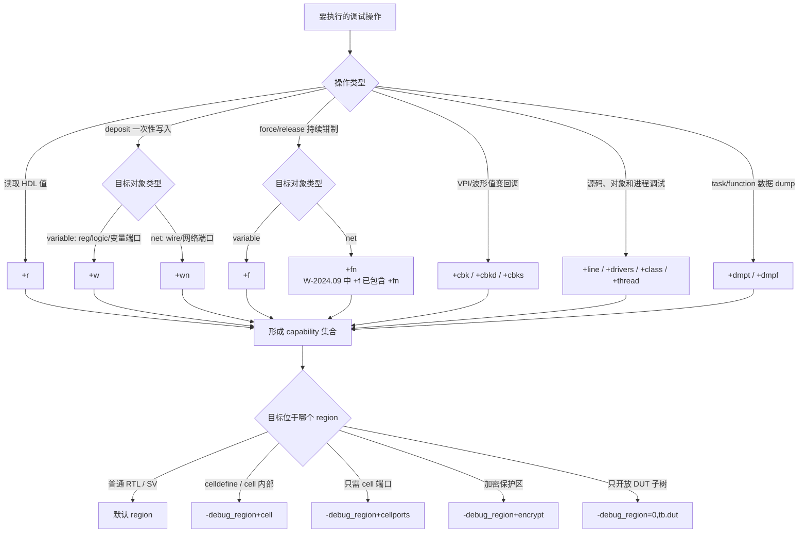

# AIP Core

面向 UVM 验证环境的 SystemVerilog 工具库 + Tcl 命令桥接 + C 固件框架。
完成一次 simv 构建后，可以反复用 Tcl 脚本执行用例、启动 UVM sequence、改运行期参数、
并行和断点续跑；修改 SV/TB、命令注册或内嵌 Tcl 模块时仍需重新编译或重建对应产物。

## 目录

1. [快速开始](#1-快速开始)
2. [在 SV 中注册命令](#2-在-sv-中注册命令)
3. [在 Tcl 中使用命令](#3-在-tcl-中使用命令)
4. [参数注册与随机化（aip_cmdline）](#4-参数注册与随机化aip_cmdline)
5. [UVM sequence 当命令用](#5-uvm-sequence-当命令用)
6. [日志 / 时钟 / 时间 / 字符串工具](#6-日志--时钟--时间--字符串工具)
7. [UCLI 后门工具（fv / gv / mem ECC）](#7-ucli-后门工具fv--gv--mem-ecc)
8. [断点续跑与 Ctrl+C 续跑](#8-断点续跑与-ctrlc-续跑)
9. [TCP 远程命令（aip_c_bridge）](#9-tcp-远程命令aip_c_bridge)
10. [CPU 固件命令（aip_cpu_bridge）](#10-cpu-固件命令aip_cpu_bridge)
11. [运行时 C 插件（aip_soload）](#11-运行时-c-插件aip_soload)
12. [Filelist timescale 检查工具](#12-filelist-timescale-检查工具)
13. [回归测试](#13-回归测试)
14. [常见问题](#14-常见问题)
15. [VCS Debug Access 能力图与选项速查](#15-vcs-debug-access-能力图与选项速查)

详细用户手册和文档维护入口见 [`docs/README.md`](docs/README.md)；源码/API 级参考见
[`docs/REFERENCE.md`](docs/REFERENCE.md)。

---

## 1. 快速开始

### 1.1 编译要求

| 项 | 要求 |
|---|---|
| 仿真器 | VCS Q-2020.03 及以上（W-2024.09 已验证） |
| include | `+incdir+<aip_core> +incdir+<aip_core>/src/sv` |
| filelist | 工程 filelist 用大写 `-F <aip_core>/aip_core.f`（只含相对该文件的 `+incdir+./`、`+incdir+./src/sv` 与根入口 `aip_core_pkg.sv`，可在任意目录编译），放在所有依赖 AIP 的项目的 `-F` 之前；使用方在自己的 package/module 内 `` `include "aip_core_import.svh" ``（即 `import aip_core_pkg::*;`） |
| timescale | 必须 `-timescale=1ns/1ps`，否则 `aip_time` / `aip_clk` 延迟为零、时钟死循环 |
| debug access | 标准集成建议 `-debug_access+r+w+f+wn`；其中 Tcl bridge/快照本身只需 `+r+w+f`，`+wn` 用于 `fv`/`dut_deposit` 写 DUT `wire/net`。各 capability 必须用 `+` 分隔，**`+rwf` 连写无效**；完整选择方法见[第 15 节](#15-vcs-debug-access-能力图与选项速查) |
| 入口顺序 | `` `include "aip_core_pkg.sv" `` 必须是每个 compilation unit 里**第一个** AIP 文件 |

TB 源文件开头 include 统一入口，需要的地方 `import aip_core_pkg::*`：

```systemverilog
`include "aip_core_pkg.sv"

package user_pkg;
    import uvm_pkg::*;
    import aip_core_pkg::*;
    class user_cfg;
        int value;
    endclass
endpackage
```

规则：

- 不要先 include `aip_log.sv` / `aip_cmdline.sv` / `aip_cmd.sv` 等单个组件再 include 入口。
  VCS 会报 `AIP_CORE_PKG_PREINCLUDE_ERROR`，修法是把 `aip_core_pkg.sv` 放到最前。
- 可以在同一次 VCS analysis 里依次分析 `aip_core_pkg.sv` 和使用者，但不要拆成彼此独立的
  `vlogan` 调用。
- `aip_clk` / `aip_clk_if` 不在 package 里（interface 不能放 package）。用时钟的 module 必须与
  统一入口处于同一 compilation unit，照上面在 TB 源里 include 即可；只 `import` package 的
  独立 `vlogan` 单元看不到 `aip_clk`。

### 1.2 最小 TB

```systemverilog
`include "aip_core_pkg.sv"
import uvm_pkg::*;
import aip_core_pkg::*;

class my_ops;
    static task hello();
        $display("Hello from SV!");
    endtask
    static task write_reg(input int addr, input int data, output int status);
        $display("write: 0x%0h = 0x%0h", addr, data);
        status = 0;
        #10;
    endtask
endclass

`aip_cmd_task(hello, my_ops::hello)
`aip_cmd_2i1o(wr, my_ops::write_reg, int, addr, 0, int, data, 0, int, status)

module tb;
    `aip_clk_create(clk0, 100e6)      // 100 MHz 时钟，信号为 clk0_if.clk
    `aip_tcl_bridge_create(tcl)        // 启动 Tcl 桥接
    initial begin
        `aip_cmd_info(hello, "basic", "Say hello", "none")
        `aip_cmd_info(wr, "reg", "Write register", "addr:int data:int -> status:int")
    end
endmodule
```

### 1.3 编译并运行

```bash
vcs -sverilog -ntb_opts uvm -full64 -timescale=1ns/1ps -debug_access+r+w+f+wn \
    +incdir+<aip_core> +incdir+<aip_core>/src/sv tb.sv -o simv
# filelist 写法等价：用 -F <aip_core>/aip_core.f（大写 -F，路径相对该 filelist）代替两个 +incdir+

./simv -ucli -do test.tcl +UVM_NO_RELNOTES     # 批处理：脚本跑完退出
./simv -ucli -i  test.tcl +UVM_NO_RELNOTES     # 交互：脚本跑完停在 ucli% 继续手敲
```

`test.tcl`：

```tcl
source <aip_core>/dist/aip_init_so.tcl   ;# 加载 AIP Tcl 命令库（每个脚本第一行）

hello                                    ;# SV 注册的命令直接敲
wr addr=0x100 data=0xFF                  ;# 带参数
puts [aip_read_result]                   ;# 上一条命令的返回字符串
aip_send_cmd "help"                      ;# help 与 VCS 内置命令重名，显式发送
run 50ns                                 ;# VCS 原生命令照常混用
end_test                                 ;# 必须：结束仿真，UVM 走正常 report/$finish
```

`dist/aip_init_so.tcl` 依赖 `dist/lib/` 下的库，首次使用先 `make -C <aip_core>/dist all`
（发布包已自带则不需要）。同一个 Tcl 解释器里重复 source 是幂等的。

相对 `source` 路径按仿真进程的当前工作目录解析；含空格时用引号或花括号包住路径。
VCS 若没有提供脚本文件元数据，loader 会从字面的 `source` 命令恢复路径，并尝试
`AIP_CORE/dist`、当前目录及其 `dist` 子目录。使用动态路径时建议明确指定：

```tcl
set ::env(AIP_CORE) /path/to/aip_core
source [file join $::env(AIP_CORE) dist aip_init_so.tcl]
```

定位失败会列出当前目录和候选路径；若缺少 `.so`，先构建分发库。

### 1.4 常用集成命令行（含 TCP 桥接与 C 插件）

```bash
vcs -sverilog -ntb_opts uvm -full64 -timescale=1ns/1ps -debug_access+r+w+f+wn \
    +incdir+<aip_core> +incdir+<aip_core>/src/sv \
    +define+AIP_ENABLE_SOLOAD \
    -LDFLAGS "-L<aip_core>/dist/lib -Wl,-rpath,<aip_core>/dist/lib \
              -laip_soload -laip_socket_dpi -ldl" \
    tb.sv -o simv
```

- `+define+AIP_ENABLE_SOLOAD` + `-laip_soload`：只在用 [运行时 C 插件](#11-运行时-c-插件aip_soload) 时需要。
- `-laip_socket_dpi`：只在用 [TCP 远程命令](#9-tcp-远程命令aip_c_bridge) 时需要。
- `-rpath` 让 simv 不依赖 `LD_LIBRARY_PATH`。

---

## 2. 在 SV 中注册命令

命令是 static task/function，用宏注册一次，之后 Tcl / TCP / C 固件三条路径都能调。
参数写法统一是 `name=value`，缺省用宏里给的默认值；输出参数自动格式化为
`name=value` 字符串返回给调用方。

```systemverilog
// 无参数
`aip_cmd_task(my_cmd, my_class::my_task)

// N 个输入（aip_cmd_1i … aip_cmd_10i）
`aip_cmd_1i(print_val, ops::print_val, int, val, 0)
`aip_cmd_2i(set_range, ops::set_range, int, low, 0, int, high, 100)
`aip_cmd_3i(config3,   ops::config3,   int, a, 0, int, b, 0, int, c, 0)

// 带输出（最多 5 入 3 出）
`aip_cmd_1i1o(read_reg,  ops::read_reg,  int, addr, 0, int, rdata)
`aip_cmd_2i1o(write_reg, ops::write_reg, int, addr, 0, int, data, 0, int, status)
`aip_cmd_2i2o(rmw_reg,   ops::rmw_reg,   int, addr, 0, int, mask, 0, int, old_val, int, new_val)

// 字符串输入
`aip_cmd_str_1i(echo, ops::echo, msg, "default")

// 枚举输入
`aip_cmd_enum_1i(set_mode, ops::set_mode, mode_e, mode, MODE_IDLE)
`aip_cmd_enum_1i1o(check_mode, ops::check_mode, mode_e, mode, MODE_IDLE, int, status)

// 自己解析参数：task 收整段 args 字符串，用 aip_cmd::get_arg(args, "addr") 取值
`aip_cmd_task(dma_config, ops::dma_config)

// 可选：帮助信息（Tcl 里 aip_send_cmd "help" 显示；组名、描述、参数说明）
`aip_cmd_info(write_reg, "reg", "Write register", "addr:int data:int -> status:int")
```

UVM sequence 也能注册成命令（`aip_cmd_seq` / `aip_cmd_user_seq` /
`aip_cmd_reg` / `aip_cmd_cseq` / `aip_cmd_creg`），见
[第 5 节](#5-uvm-sequence-当命令用)；声明过的 sequence 类型还可由 Tcl `aip_bind_seq`
运行时绑定到 sequencer 生成新命令（5.5 节）。CPU 固件命令用
`aip_cmd_cpu`，见 [第 10 节](#10-cpu-固件命令aip_cpu_bridge)。

SV 内部也可以直接执行命令字符串：

```systemverilog
aip_cmd::exec("write_reg addr=0x100 data=0xFF");
aip_cmd::exec("fork cmd1, cmd2, cmd3 join");
aip_cmd::exec("fork cmd1, cmd2 join_any disable_remaining=1");

real ns = aip_cmd::parse_time_ns("1us");    // 时间字符串 → ns，1000.0
```

未知命令的处理按来源不同：Tcl 和 TCP 来源返回 `status=-1` 软失败，仿真继续；SV 内部
`exec()` 和 DPI 来源 `$fatal`。

---

## 3. 在 Tcl 中使用命令

脚本第一行 `source <aip_core>/dist/aip_init_so.tcl`，之后 SV 注册的命令名直接当 Tcl
命令用（Tcl 不认识的命令自动转发给 SV）。

### 3.1 调用、返回值与回显

```tcl
write_reg addr=0x100 data=0xFF       ;# 直接输入
read_reg addr=0x200                  ;# 有返回值
set_mode mode=MODE_RUN               ;# 枚举参数
dma_config addr=0x1000 len=128       ;# 自解析参数

puts [aip_read_result]               ;# 上一条命令返回的字符串，如 "rdata=0x55"
if {[aip_check_status]} { puts "failed" }   ;# 非 0 = 上一条命令失败

aip_send_cmd "help"                  ;# 与 VCS/Tcl 内置命令重名（help、run …）时显式发送

puts [aip_getparam UVM_TESTNAME]     ;# 读任意 +name=value plusarg 的字符串值
puts [aip_getparam ntb_random_seed]  ;# name=seed 且未显式 +传时退到实际初始种子
# 未传该 plusarg → 返回空串，aip_check_status 为 1
```

每条命令执行时打印一行橙色回显，自动带脚本绝对路径和仿真时间；`source` 子文件时路径
自动切换：

```text
[tcl_cmd] /home/user/test/my_test.tcl @ 100.00 ns: axi_write count=10
```

`set ::aip_echo 0` 关闭回显。`$stop` 的源码位置打印已被自动抑制。

已注册命令即使执行失败（`status=-1`，例如被看门狗终止）也返回该命令的错误结果，不会变成
Tcl 的 `invalid command name`。

### 3.2 运行时改参数

对 `aip_cmdline` 注册的参数（见第 4 节）在运行时覆盖，优先级 override > plusarg > 默认值。
下一次读取参数的对象（如 sequence 里 create 的 transaction）立即生效，不重编译不重启：

```tcl
set_param path=axi.wr.addr value=0x2000
set_param path=axi.wr.data value=0xCAFE
axi_write count=10                    ;# 这 10 个 trans 全部用新参数
set_param path=axi.wr.addr {value=[50:200]}
set_param path=axi.wr.len {value={64:=30,128:=50,1500:=20}}

set_param {                           ;# 块写法，一次设多个，值可用随机语法
    axi.wr.addr  [0:0xFFFF]
    axi.wr.len   1,2,4,8,16
}
clear_param path=axi.wr.addr          ;# 清单个，回退到 plusarg
clear_param                           ;# 清全部
```

SV 侧对应 `aip_cmdline_override::set_val("axi.wr.addr", "0x2000")` /
`clear("axi.wr.addr")` / `clear_all()`。

随机表达式在 SV 每次执行类型宏时求值，`set_param` 本身只存原文。单项写法必须用
`{value=[50:200]}` 保护整个 Tcl 单词；`value={[50:200]}` 中的括号不在单词开头，
Tcl 仍会尝试执行 `[50:200]`。块写法的外层花括号可保护整段文本。
扩展版 SV 库需要重新编译一次，之后运行期改值不需要重编译。

### 3.3 并行

#### 单条命令选择等待或后台启动

对注册的用户 task/sequence，`wait` 是 AIP 调度参数，不是用户业务参数。
每次调用独立决定是否等待，未写时始终默认 `wait=1`：

```tcl
pcie_link_up wait=0       ;# 后台启动，立即返回 status=0 / STARTED: pcie_link_up
init_task wait=0          ;# task 同样支持，不等待它执行结束
pcie_ep_cfg bdf=0x0100    ;# 没写 wait：等待这条命令执行结束，再继续
memory_read wait=1        ;# 显式同步，返回本次真实执行结果
```

`wait=0` 不等待 sequence 的 `start()` 或 task 返回，也不以该后台任务迟迟未
完成作为 Tcl ACK/命令停滞超时。返回成功仅表示框架接受并启动了任务，不承诺
链路已进入 L0、事务已完成或后台业务最终成功。后台完成/失败不会覆盖后续
命令的 ACK、status 或结果；用户代码内部的 timeout、UVM_FATAL 或 `$fatal`
仍按自身逻辑生效，不会被此参数屏蔽。UCLI 暂停期间整个仿真也暂停，后台
任务只有在下一条命令推进仿真或 `run` 时才继续执行。
后台业务返回的普通非零 `status` 只记录到 `[AIP_CMD_BACKGROUND]` 日志，
不会补发第二次 Tcl 返回；需要检查执行结果的命令应使用默认同步模式。

框架会先校验并剥离顶层 `wait=0/1`，用户原来的 seq/task 无需新增 `wait`
字段或参数解析。重复、空值和非0/1的 `wait` 在执行前拒绝；花括号/引号包裹
的业务值内部出现 `wait=0` 不作为框架开关。每条命令的缺省值重新初始化，
不会把上一条的后台模式带到下一条，也不会修改全局 watchdog 设置。
没有顶层 `wait` 时，交给用户的 `args_in` 保持原始参数串，不去掉业务末尾
逗号或重排空白；有 `wait` 时只移除控制 token 及其必要分隔。`wait` 是框架
保留键，旧业务若本身有同名参数，需要改业务键名，不能同时解释为两种含义。

同名命令还在执行时，再次调用返回 `BUSY`，不覆盖原任务的参数和结果；
需要并行执行同一 sequence 类型时，仍应注册不同命令名、绑定对应目标。
`end_test`、`set_cmd_watchdog` 等 bridge 控制命令不可后台化；CPU mailbox 命令（`aip_cmd_cpu`）继续使用
自己的 `async=1` 协议，不把 `wait` 与 CPU 异步协议混用。

支持范围：`aip_cmd_task`、整型/枚举参数 task 宏，以及建立在 task 宏上的
`aip_cmd_seq`、`aip_cmd_user_seq`、`aip_cmd_cseq`、`aip_cmd_reg` 和
`aip_cmd_creg`；字符串/混合参数宏也支持，返回模式见下节。
直接派生 `aip_cmd` 的自定义命令默认仅同步；确认使用 `set_result()` 或自身
handle 返回 `status/result_out` 后，可派生 `aip_cmd_user_task` 开放后台执行。
并发 SV 调用方应使用
`aip_cmd::exec_result(cmd, source, status, result)` 获取本次结果，不能依赖
全局“最近结果”变量。

后台任务不自动阻止 `end_test` 结束测试。若后续操作依赖后台初始化完成，
用户应设置明确的就绪条件/检查器再访问，而不是把 `STARTED` 当作业务完成。
手动 `kill_seq` 或 watchdog 取消也不保证修复 driver 的未完成协议状态。

定向验证入口为 `make test_cmd_wait`（在 VCS 主机运行）。该用例通过真实
UVM sequencer/driver 检查启动 ACK、下一条默认同步、参数隔离、非法参数、
取消后重入、用户 task 的 `disable fork`/`wait fork` 作用域，以及旧字符串
返回槽兼容；Tcl/SV 两侧都必须出现 PASS，且 UVM ERROR/FATAL 为 0。

#### 旧字符串宏：保留调用方式，选择结果通道

以下八种宏保留原宏名、原参数顺序和用户 task 签名，仅在末尾增加可选的
`LOCAL_RESULT=0`：`aip_cmd_str_1i`、`aip_cmd_str_2i`、
`aip_cmd_str_1i_status`、`aip_cmd_str_2i_status`、`aip_cmd_str_3i_status`、
`aip_cmd_str_3i_status_time`、`aip_cmd_str_1i1i`、`aip_cmd_1i1s`。
这是 SV 注册选项，不是 Tcl 业务参数；已有 Tcl 命令写法不变。

省略尾参时仍兼容旧 task 直接写 `aip_cmd::__aip_cmd_last_status/result`，
现在也允许 `wait=0`，但所有此类 legacy 命令共用一个结果槽，同一时刻只允许
一条独立调用链占用。另一个线程的 legacy 命令即使名字不同或写了 `wait=1`，
也会返回 `BUSY`，不会排队；使用独立结果的其他命令可以继续运行。框架暂停兼容全局镜像的
无关写入，避免覆盖在途 legacy 结果；Tcl/Socket 仍使用各自调用的输出结果。

同一调用链内，不同名字的 legacy 命令可以通过 `exec()` / `exec_result()`
同步嵌套，包含中间经过局部结果命令的情况。子调用临时接管旧槽，返回或被
取消时恢复仍存活的父调用。`exec_result()` 只输出子结果并恢复父槽原值；
旧 `exec()` 会再把子结果发布给父调用读取。此兼容不允许同名重入、嵌套
`wait=0` 抢占外层 legacy 槽，或用户自行 fork 的线程借用父槽。

需要不同命令并发时，将 task 的结果写入改为 `aip_cmd::set_result()`，
并在原宏末尾追加 `1'b1` 即可，无需换宏或给 task 增加返回参数：

```systemverilog
class user_ops;
    static task echo_text(string text);
        // 替代旧的两次 __aip_cmd_last_* 赋值，写入当前调用独立结果。
        aip_cmd::set_result(0, {"echo:", text});
    endtask
endclass

`aip_cmd_str_1i(echo_text, user_ops::echo_text, text, "", 1'b1)
```

Tcl 仍用 `echo_text text=hello` 或 `echo_text text=hello wait=0`。
不能只追加 `1'b1`、却让 task 继续写全局槽；这种写入无法由框架拦截，会污染
其他 legacy 命令。显式 `set_result()` 优先于宏的缺省成功或输出拼装；没有
写结果的字符串 task 默认返回 `status=0`、空结果。同名调用的 `BUSY` 保护
仍然有效，局部结果不意味着同一个注册对象可以重入。

`set_result()` 可用于命令主执行线程及其普通 task/function 调用。
`get_current_context()` 严格匹配当前 `process`，不会沿父子线程自动继承。
UVM `sequence.start()` 内部 fork 出的 `body()` 同样不自动获得该上下文；
现有 sequence 继续通过 `aip_cmd::get_handle(get_name())` 访问参数和自身
结果，或由启动方显式传入已捕获的 `ctx`，不能直接在任意 `body()` 中调用
`aip_cmd::set_result()`。

若要从 `fork` 子线程回报，必须在 fork 前捕获上下文，再显式传给子线程：

```systemverilog
// 以下代码位于已注册的用户 task 内。
aip_cmd_result_context ctx;
ctx = aip_cmd::get_current_context();
fork
    begin
        #100ns;
        ctx.set_result(0, "child completed");
    end
join  // 确保子线程提交结果后，命令才返回。
```

上下文只属于本次调用，正常返回或被取消后失效；迟到的 `ctx.set_result()`
会 `$fatal`，不能影响下一次调用。没有命令上下文时调用快捷
`aip_cmd::set_result()` 也会 `$fatal`，不会退回共享全局槽。
task、typed/enum 及上述八种宏均兼容顺序 `get_handle()` → 设置 `args_in`
→ `cmd_exec()` 的旧 SV 入口，返回时更新 handle 和可安全发布的旧全局镜像，
例如直接调用 `cpu_wait`、`load_image`。另一个线程的 legacy 槽在途时不会被
无关镜像覆盖；需要并发返回值时使用 `exec_result()`，不要读取“最近结果”。
直接 `cmd_exec()` 不支持嵌套/重入，也不能保护调用方事先自行写入的 `args_in`；
并发或嵌套派发应使用 `exec_result()`，不要自行改写活动句柄参数。

内置 `aip_dut_control_ops::*` 和 `aip_cpu_loader_default::*` 也支持直接
SV 调用：没有命令上下文时，在业务开始前建立临时兼容 scope，返回时更新
全局状态/文本；在命令内部则复用该次上下文。直接调用从进入到返回期间持有
旧全局槽，若其他线程已占用则明确 fatal，不执行硬件操作后才发现结果冲突。
这只是内置旧入口的兼容包装，普通 `aip_cmd::set_result()` 仍不允许无上下文
调用。`set(loader)` 和成功的 `check()` 等纯配置/查询接口不创建结果 scope。
旧 legacy task 内调用这些 facade 时，结果仍立即写入它所持有的全局槽，
允许 task 随后读取或覆盖旧返回值；local/typed 命令内则继续写独立上下文。
该兼容由 facade 专用 `set_compat_result()` 实现，仍要求已有有效上下文；
用户主动调用普通 `set_result()` 的显式结果优先规则不变。

执行进程边界也需注意：同步命令和后台命令都有自己的 worker。用户 task
内部的 `disable fork` / `wait fork` 只影响该次 worker 的子线程，不影响前一条
后台命令。若 task 内自行 `fork ... join_none`，不要在外部依赖
`aip_cmd::exec(...); wait fork;` 等待这些后代；应在 task 内 `join` / `wait fork`，
或用业务完成事件/检查器表达就绪。此隔离行为不会恢复成旧的共享进程树。

内建 DUT HDL 控制与 CPU loader 命令已迁移到独立结果；但这不为同一个 HDL
信号或内存区域提供业务互斥。重叠 force/release、装载写入及 loader 重绑仍
需由 TB 排序，取消命令也不会自动回滚已生效的 force 或内存写入。

在 VCS 主机运行 `make test_cmd_result_context`，覆盖八种宏、legacy 后台与
局部结果并发、嵌套派发、取消后复用、直接入口兼容，以及 `cpu_wait` 的
缺失 loader、同步/后台超时和成功结果传播。正常组要求
`CMD_RESULT_CONTEXT_PASS`；无上下文、过期/被取消上下文及直接嵌套/重入属于
预期 fatal 负例，由 runner 核对具体诊断和退出码，不能只凭日志含 FATAL 判失败。

`make test_cmd_compat` 单独检查旧 SV 入口、静态 facade、兼容全局镜像、
legacy 同步嵌套/并发互斥以及原始参数保真。`make test_checkpoint_background`
在 local task、legacy task 和真实 UVM sequence 三者仍在运行时保存快照，
恢复后比较运行次数、BUSY/参数、完成结果及 driver 事务数，不能只检查 Tcl 能
重新 source。该快照覆盖不等于外部 Socket/文件资源或任意厂商 VIP 已验证。
`make ci-cmd` 聚合上述门禁和 Tcl/Socket/sequence/watchdog 回归，`make ci`
通过 `ci-regress` 自动包含它们，不再依赖手工单独运行新测试。

#### 多命令 fork/join

```tcl
fork                                  ;# 多行写法（SV 风格）
    axi_write count=10
    eth_send  count=5
join                                  ;# 等全部完成

fork
    axi_write count=100
    axi_read  count=50
join_any                              ;# 等任一完成
join_any disable_remaining=1          ;# 任一完成后杀其余

fork
    axi_write count=10
join_none                             ;# 后台跑，不等

fork axi_write count=5, eth_send count=3 join    ;# 单行写法，逗号分隔（断点续跑场景推荐）

fork                                  ;# time 与 count 混合
    axi_write time=1us
    eth_send  count=50
join
```

与 VCS/Tcl 原生命令自由混合，可以用循环和 proc 组织用例：

```tcl
run 100ns                             ;# VCS 原生
set clk [get top.clk0_if.clk]         ;# VCS 原生
axi_write count=3                     ;# SV 命令
puts "done"                           ;# Tcl 原生

for {set i 0} {$i < 10} {incr i} {
    set_param path=axi.wr.addr value=[format "0x%X" [expr {$i * 0x1000}]]
    axi_write count=1
}

proc burst_test {addr data count} {
    set_param path=axi.wr.addr value=$addr
    set_param path=axi.wr.data value=$data
    axi_write count=$count
    return [aip_read_result]
}
burst_test 0x5000 0xFF 10
```

### 3.4 结束仿真

```tcl
end_test                                   ;# 立即结束
end_test drain=1000                        ;# 再跑 1000ns drain 后结束
end_test wait_done=1 timeout=2ms strict=1  ;# 等所有已注册的结束检查器完成（见 3.6）
end_test drain=100us cmd=vio_release       ;# 等 drain 后执行一个清理命令
end_test idle=1us cmd=vio_stop cmd=vio_release ;# 按顺序执行多个清理命令
# 也可以把清理命令写成一个分号列表（大括号保护列表）
aip_send_cmd {end_test {cmd=vio_stop;vio_release}}
```

`end_test` 返回后 UVM 正常走 extract → check → report → `$finish`。不调用则仿真不会结束。
`cmd=` 清理命令在 drain、`wait_done` 和 idle 等待完成后同步执行；命令按出现顺序执行。
清理命令失败会保留后续命令并使 `end_test` 返回失败。`end_test`、`fork` 和插件装载/卸载命令不能作为清理命令嵌套调用。

### 3.5 卡死保护（命令看门狗）

一条命令连续 50us（默认阈值）没有任何进展，会被自动杀掉并返回错误，后续命令继续执行。
判据是"多久没进展"，不是"跑了多久"：正常长命令不会因为耗时长被误杀，只有零进展才被杀。
进展信号靠 `aip_activity::tick()`：

| seq 类型 | 执行中要不要 `tick()` | 原因 |
|---|---|---|
| 短 seq（< 50us 跑完） | 不需要 | 到不了超时窗口 |
| 长 seq（> 50us） | **必须周期 tick** | 否则被误判死锁 |
| 死锁 seq（等永不来的 response） | —— | 无 tick 正是判据 |

`aip_cmd_seq` / `aip_cmd_reg` 宏只在 seq 跑完后 tick 一次，所以长 seq 要自己喂狗。
推荐放在 driver 里，一处改全部受益：

```systemverilog
// 方式 1（推荐）：driver 每处理一个 item 喂一次
task run_phase(uvm_phase phase);
    forever begin
        seq_item_port.get_next_item(tr);
        // ... 驱动 ...
        aip_activity::tick();
        seq_item_port.item_done();
    end
endtask

// 方式 2：seq body 每发一包喂一次
// 方式 3：monitor / scoreboard 每收一包喂一次
```

`aip_activity::tick()` 是全局活动计数，不是逐命令的独立进度：其他后台任务
持续 tick 也会延后前台命令的停滞超时。需要业务级绝对期限时，仍应在用户
sequence/task 内设置自己的 timeout。

Tcl 等待 ACK 用同一判据：`::aip_ack_timeout_ns`（默认 52000 = 默认 stall 50us + 2×poll 1us）
是"没有活动进展"的最长时间，只要 tick 计数还在变就一直等到 ACK，长命令拿到的是自己的
结果而不是上一条的陈旧结果。看门狗启用时 Tcl 至少等 `stall + 2×poll`（从 SV 读取，
`set_cmd_watchdog` 改阈值后自动跟随），所以总是先收到看门狗的错误结果；看门狗禁用时由
`::aip_ack_timeout_ns` 兜底，到期打印 `WARN: cmd N no ack after ...ns without activity progress`
后返回，不会无限等待。要容忍更长的无 tick 静默段就调大它（如 `set ::aip_ack_timeout_ns 5000000`）；
低于看门狗所需的值不会生效，想更快失败应调小看门狗阈值。pause% 中转入注入队列的普通命令和
`aip_job wait` 也按无进展计时（见 8.2）。定向验证入口为 `make test_cmd_ack_progress`。

配置与手动控制：

```systemverilog
aip_tcl_bridge::set_cmd_watchdog(100000);   // 阈值改为 100us
aip_tcl_bridge::set_cmd_watchdog(0);        // 禁用
```

```tcl
set_cmd_watchdog ns=100000      ;# 改阈值，不重编译
watchdog_status                 ;# 看配置 + 活动 seq 数
kill_seq name=my_seq            ;# 手动杀指定 seq
kill_seq                        ;# 杀全部活动 seq
```

看门狗触发时自动只杀卡死的那条命令的 seq（`fork` 并行命令则杀它启动的全部子 seq），
不碰其他并行/后台 seq。需要补做清理（复位 mailbox flag、外部资源）时可挂 hook：

```systemverilog
class my_hook extends aip_cmd_watchdog_hook;
    function void on_timeout(string cmd_str);
        // 按命令类型补做清理
    endfunction
endclass
my_hook h = new();
aip_tcl_bridge::set_watchdog_hook(h);
```

不挂 hook 也能恢复，hook 只补框架清理不到的状态。

### 3.6 精确结束条件（结束检查器）

`tick()` 只表示"还在活动"，不能证明 scoreboard 已经比对完。需要精确完成条件时，为每个
组件实现并注册一个命名 `aip_end_checker`：

```systemverilog
class my_scoreboard_checker extends aip_end_checker;
    string       checker_name;
    int unsigned matched = 0, expected = 0, pending = 0, mismatches = 0;

    function new(string checker_name, int unsigned expected);
        this.checker_name = checker_name;
        this.expected     = expected;
    endfunction
    virtual function bit is_done();       return matched == expected && pending == 0; endfunction
    virtual function bit has_failed();    return mismatches != 0; endfunction
    virtual function string status_detail();
        return $sformatf("%s matched=%0d expected=%0d pending=%0d mismatches=%0d",
                         checker_name, matched, expected, pending, mismatches);
    endfunction
endclass

initial begin
    my_scoreboard_checker axis_checker = new("axis_scoreboard", 128);
    my_scoreboard_checker shm_checker  = new("shm_transport",   64);
    // expected 确定后、流量启动前注册
    aip_tcl_bridge::register_end_checker("axis_scoreboard", axis_checker);
    aip_tcl_bridge::register_end_checker("shm_transport",   shm_checker);
end
```

scoreboard 收到工作时 `pending++`，每完成一次比较 `pending--` 并按结果 `matched++` 或
`mismatches++`。Tcl 里：

```tcl
end_test wait_done=1 timeout=2ms strict=1
```

- 任一 checker `has_failed()` 返回 1 即失败，`strict=0` 也不会降级为成功。
- `strict=1` 时，超时或没有任何 checker 都算失败；非 strict 保留强制退出行为。
- `end_test` 开始等待后 checker 集合被冻结，期间 `register_end_checker()` /
  `unregister_end_checker()` / `clear_end_checkers()` 被拒绝。
- 看门狗杀掉正在执行的 `end_test` 时，bridge 会清理等待状态并有序退出，UVM 仍能进 report。

---

## 4. 参数注册与随机化（aip_cmdline）

在任意 class 的 `new()` 或 module 里注册变量，值来自 `+path.name=value` plusarg、
Tcl `set_param` 覆盖，或宏默认值。每次执行到宏时重新读取。
按第 8.1 节执行 `aip_restore` 并重新加载 Tcl 后，AIP 参数宏读取本次启动 simv 的
plusargs；未执行 restore 的普通仿真仍使用原有读取路径。

```systemverilog
int count;      `aip_int("dut", int, count, 1)            // +dut.count=10 / -10 / -0x20
string name;    `aip_string("dut", name, "default")       // +dut.name=hello
real freq;      `aip_real("clk", freq, 100.0e6)           // +clk.freq=156.25e6
bit [255:0] k;  `aip_int("dut", bit [255:0], k, 0)        // 宽位，最大 1024 bit

int arr[];      `aip_int_list("dut", int, arr, 0)         // 动态数组 +dut.arr=1,2,3
int tbl[4];     `aip_int_slist("dut", int, tbl, 0)        // 静态数组 +dut.tbl=4,3,2,1
string names[]; `aip_str_list("dut", names, "")           // 字符串数组（静态用 aip_str_slist）

typedef enum {FAST, SLOW} speed_e;
speed_e spd;    `aip_enum("dut", speed_e, spd, FAST)      // +dut.spd=SLOW / 1 / rand

typedef enum {CSUM = 0, TSO = 11, V1 = 32} feat_e;        // 成员值为位号
bit [63:0] feat; `aip_flags("dut", feat_e, feat, 0)       // +dut.feat=V1,CSUM 或 +dut.feat=0x100000001

typedef struct { int addr; int len; string name; } cfg_t;
cfg_t cfg;
`aip_struct_begin("dut", cfg)                             // +dut.cfg={addr=0x100,len=64,name=x}
    `aip_struct_int(cfg, addr, 0)                         // 或 +dut.cfg.addr=0xFF（点号优先）
    `aip_struct_int(cfg, len, 64)
    `aip_struct_string(cfg, name, "x")
`aip_struct_end(cfg)
```

path 支持多级，如 `"eth.ipv4.tcp"` → `+eth.ipv4.tcp.len=…`。

整数目标按类型区分有无符号，取值都不截断、不回绕，越界即 hard fatal，报错给出参数名、原文与允许范围：

- 无符号目标（`bit`/`logic` 位向量、`* unsigned`）：负数（含 `-0`、`-8'h1`）与超出位宽的值都报错。
- 有符号目标（`int`/`byte`/`shortint`/`longint`/`integer`、`bit signed [N:0]`）：纯十进制（可带负号）须在
  [-2^(N-1), 2^(N-1)-1] 内；带基数或位宽的写法（`N'h…`、`'h…`、`'b…`、`'o…`、`'d…`、`0x…`、`0b…` 等）是位模式，
  须放得进 N 位并按补码解释，如 `32'hFFFF_FFFF` 给 `int` 得 -1，而 `4294967295` 给 `int` 报错；带负号的基数写法
  （如 `-8'h1`）取其无符号值的相反数，不得小于 -2^(N-1)。

例如：

```text
[FATAL] cfg.sv(42) ... AIP_CORE[cmdline] parser Error: negative value -1 for unsigned 64-bit longint unsigned (allowed 0..18446744073709551615) parameter='+dut.timeout_ns' value='-1'
```

该规则作用于 plusarg、`set_param` 运行期覆盖、随机语法里的每个取值（范围端点、列表项、权重组左值、`inc/dec`
端点）、数组整体值/索引/`.each`、严格 queue、schema 字段、旧版 `aip_struct_int`（按成员自身类型解析）与
`aip_flags` 掩码；权重与步长仍按各自规则报错。需要全 1 时写出上界（如 `8'hff`、`64'hFFFF_FFFF_FFFF_FFFF`）。

#### 可选参数、路径别名与键使用记录

`_opt` 宏用于"给出才改、没给保持"的配置：变量当前值即默认值，可选的 `given` 标志告知是否给出。

```systemverilog
bit changed;
`aip_int_opt("eth0.outer_ipv4", bit [7:0], ttl, changed)    // +eth0.outer_ipv4.ttl=[32:64]
`aip_string_opt("dut", label)
`aip_enum_opt("dut", speed_e, spd)                           // 名称 / 成员值 / rand
`aip_int_list_opt("dut", byte unsigned, opts)                // 动态数组或 queue
`aip_int_slist_opt("dut", bit [31:0], addrs)                 // 静态数组
void'(aip_cmdline#(bit [7:0])::get_optional("code", path, icmp_code));  // 键名与变量名不同时
```

- 来源按 override(完整、别名、叶名) 再 plusarg(完整、别名、叶名) 选一个；缺失或空值（含空 override）都保持变量，
  空值同时屏蔽其后来源（`aip_int` 的空 override 仍取类型初值，规则不变）。非空值按对应基础宏的语法求值，非法即 hard fatal。
- `given`（最后一个可选参数）只在写入时置 1、未给出时不改，便于多个参数累计到同一标志；不传则忽略。
- 只在写入时打印注册日志；`global_required` 不作用于 `_opt`。
- 容器先选根再解析：按 override(完整、别名、叶名) 再 plusarg(完整、别名、叶名) 的顺序，第一个有键（根本身、
  `根.控制键` 或 `根[i]`）的根胜出，按 `aip_int_list` 规则整体替换，未覆盖元素取 `default_val`；不同根下的键不合并，
  都没有键时保持原内容。

路径别名让同一组件既能用完整路径也能用短路径配置：

```systemverilog
aip_cmdline_alias::push("eth0.outer_ipv4", "eth0.ipv4");   // 查询 eth0.outer_ipv4[.子路径].x 时多查 eth0.ipv4[.子路径].x
layer.load_params("eth0.outer_ipv4");
aip_cmdline_alias::pop();
```

别名插在完整路径与叶名之间，作用于标量、旧版数组、`aip_cmdline_query::present` 与上述 `_opt` 宏；可嵌套（最近一次
push 优先，别名为空表示本层不提供别名），须在同一段零时间代码内成对 pop。schema 与严格 queue 入口不查别名。

枚举（`aip_enum`、`aip_enum_opt`、旧版 `aip_struct_enum`）的逗号候选除成员名外还接受等于成员值的整数字面量
（如 `0x0A`），整串 `rand` 表示全部成员（有成员恰名为 `rand` 时按名称）；范围/权重语法不适用。
`` `aip_enum_candidates(path, E, name, out) `` 只校验不抽样，把可能取到的成员放进 `E` 队列 `out`（未给出时为空）。

键使用记录用于发现"给了却没人读"的配置（拼错的键、路径层级不对的键）：

```systemverilog
string unused[$];
aip_cmdline_usage::record_begin();
cfg.load_params("eth0");                      // 期间的查询都会记下查过的键
aip_cmdline_usage::record_end("eth0", unused);  // eth0 子树下由 override/plusarg 给出、却没被查询的键，按字典序
```

记录覆盖标量、旧版数组、`present` 与 `_opt` 入口（容器按根记录），只读键名，不求值、不消耗随机数；
可嵌套，schema 与严格 queue 入口不参与。

#### 位标志（aip_flags）

`aip_flags(path, E, name, default_val)` 把 `+path.name` 读成位掩码：`E` 是成员值为位号的枚举，
目标变量最多 64 位。值有两种写法，不能混写：

- 逗号分隔的成员名（不区分大小写，可带空格、可重复），结果为各 `1 << 成员值` 之或，如 `+dut.feat=V1,CSUM`；
- 单个整数字面量，即掩码本身，写法同 `aip_int` 无符号固定值（`0x`、`N'h`、`_` 分隔，不接受负数），
  如 `+dut.feat=0x100000001`。

成员名优先于数字解析，形如 `D0` 的成员名不会被读成十进制 0。来源优先级、`set_param`/`clear_param`
与层级路径（含叶名回退）同 `aip_int`；空 override 为 0，未给出时取默认值。不支持随机语法，
读取不消耗随机数。未知名称、空项、名称与数字混写、位号或数值超出目标位宽都 hard fatal，
并报出参数路径、原始值和非法项：

```text
[FATAL] cfg.sv(42) @ 0.00 ns: AIP_CORE[cmdline_flags] Error: unknown flag 'TS0' (expected one integer mask or names of enum feat_e: CSUM, TSO, V1) parameter='+dut.feat' value='V1,TS0'
```

注册日志打印十六进制和成员名，如 `param 'feat' (scope='dut') = 0x100000801 (CSUM|TSO|V1)`。
项目代码用同一枚举的 `aip_cmdline_flags#(E)::describe(mask)`（`0x100000801 (CSUM|TSO|V1)`）或
`names(mask)`（`CSUM|TSO|V1`）格式化日志和错误信息；成员名按位号升序，没有成员名的置位位以十六进制余数结尾。

#### Schema 注册（结构体、数组与队列）

需要对结构体字段做类型安全解析时，在**用户自己的 package、module 或 class 声明区**把
schema 紧跟在 typedef 后定义；不要修改库内的 `aip_cmdline.sv`。`TYPE` 必须是调用 scope
可见的简单 typedef 名：

```systemverilog
typedef struct { int addr; string name; } cfg_t;
`aip_struct_type_begin(cfg_t)
  `aip_field_int(int, addr, 0)
  `aip_field_string(name, "default")
`aip_struct_type_end(cfg_t)

cfg_t cfg;
`aip_struct_apply("dut.cfg", cfg_t, cfg)
// +dut.cfg={addr=16'h100,name=core}
// 也可用 +dut.cfg.addr=16'h200（点号字段优先）
```

schema 定义在 package 时，推荐通配导入 type 与自动生成的 companion：

```systemverilog
import user_cfg_pkg::*;
```

选择性导入必须把两者一起导入；若使用本地别名，也必须成对 alias：

```systemverilog
import user_cfg_pkg::cfg_t;
import user_cfg_pkg::aip_struct_schema__cfg_t;

typedef user_cfg_pkg::cfg_t                    local_cfg_t;
typedef user_cfg_pkg::aip_struct_schema__cfg_t aip_struct_schema__local_cfg_t;
```

companion 名只用于宏的类型解析，不应由用户直接调用。对象成员是合法的可写 target：

```systemverilog
holder obj = new();
`aip_struct_apply("dut.cfg", cfg_t, obj.cfg)
```

结构体容器使用 `aip_struct_sarray_apply`（静态数组）、`aip_struct_darray_apply`（动态数组）或
`aip_struct_queue_apply`（队列）；整数、字符串、实数和枚举队列分别使用
`aip_int_queue`、`aip_str_queue`、`aip_real_queue`、`aip_enum_queue`。queue 的声明容量不能
可移植地反射，因此 bounded queue 必须显式传入元素数上限：

```systemverilog
cfg_t bounded_cfg_q[$:7];
int bounded_int_q[$:7];
`aip_struct_queue_apply("dut.cfgq", cfg_t, bounded_cfg_q, 0, 8)
`aip_int_queue("dut", int, bounded_int_q, 0, 8)
```

容器支持 `.size`、索引、列表以及 integral `seq`/`perm`。结构体容器的跨记录控制使用
canonical `each` owner，例如 `+dut.cfgs.each.addr.unique=1` 和
`+dut.cfgs.each.addr.sort=asc`；字段数组自身则使用
`+dut.cfgs.each.tags.unique=1` / `.sort=asc`。`unique=0` 和 `sort=none` 可显式关闭同 key
的 plusarg 控制。

这些宏只负责读取命令行/Tcl 覆盖并填充目标值，**没有内建 schema hook**。字段之间的约束
（例如地址范围或两个字段的关联关系）由用户拥有，并在 `apply` 后直接调用自己的 SV
function/task，或使用 `randomize() with` 完成。

### 4.1 随机化语法

随机源是 `$urandom`，跟随 `+ntb_random_seed`，同种子同命令行结果可复现。宏每执行一次就重新读取来源、重新抽样，
不缓存上次结果：放在循环里、每次 `new()` 或每包调用的宏，每次都可能得到不同的值；只想抽一次时，在只执行一次的
位置读取并保存结果。注册日志打印本次抽到的值，次数受 §4.2 限制，超过上限后照常抽样，只是不再打印。

**标量**（`aip_int`、`aip_struct_int` 字段、数组的每个元素位置都可用）：

| 语法 | 含义 | 示例 |
|---|---|---|
| `v` | 固定值；支持 `0x`/`0b`/`0o`、`N'h`、`_` 分隔、正负号。无符号目标（`bit[7:0]`、`int unsigned` 等）拒绝负数与越界值；有符号目标的十进制按范围检查，基数写法按补码位模式（`32'hFFFF_FFFF` 给 `int` 得 -1） | `+dut.count=-0x20`、`+dut.count=-8'd10` |
| `a,b,c` / `[a,b,c]` | 候选列表，随机选一个 | `+dut.count=[-3,-2,-1]` |
| `[lo:hi]` | 闭区间随机 | `+dut.val=[1:10]` |
| `{x:=w, [lo:hi]:=w}` | 权重随机：`:=` 每个值各占 w，`:/` 整段共占 w；权重允许为 0，整组至少有一项为正；外层 `{}` 或 `()` | `+dut.val={0:=0,[1:3]:=60}` |
| `inc:a:b[:s]` / `dec:a:b[:s]` | 从等差序列 a,a±s,…,b 中随机挑一个（步长默认 1） | `+dut.val=inc:0:100:5` |
| `rand` | 全位宽均匀随机；权重组内写 `rand:/w` | `+dut.data=rand`、`+dut.data={0:/1,rand:/9}` |

宽位：值按目标类型位宽解析，最大 1024 bit。值超出位宽、显式位宽大于类型位宽（`64'h1`
给 `int`）都报错，不静默截断。`bit [255:0]` 这类写不出 `[0:2^N-1]` 上界的用 `rand`。
范围、步进、权重随机在任意位宽下都是均匀的。

权重 `0` 表示禁用该项，它不参与抽样；负权重和整组全零会立即报错。禁用项仍需满足
原有语法、类型位宽及范围限制，不能用 `0` 隐藏非法值。该规则适用于整数标量、数组/queue
元素、schema 字段及支持权重语法的 `.size`；real 权重组也允许零权重，权重仍须为整数。
整数权重沿用目标类型的位宽限制；real 单项及累计权重上限为 `2147483647`。

```text
+dut.mode={0:=0,1:=100}          # 只可能得到 1
+dut.mode={[0:3]:/0,7:/1}        # 禁用整个范围，只可能得到 7
+dut.data={rand:/0,8:=1}         # 禁用全位宽随机分支
+dut.mode={0:=0,1:=0}           # 报错：整组权重为 0
+dut.mode={0:=-1,1:=100}         # 报错：负权重
```

参数解析错误统一使用 AIP 的 `[FATAL]` 格式，打印后立即 `$fatal(1)`，不再继续执行或静默回退成 0。
覆盖整数、real、枚举、旧版 struct、schema、数组/队列及必填参数缺失；不仅是权重错误。
参数宏自动提供用户 SV 文件与行号、完整参数路径和原始输入；
数组的 `.size`、`.each`、`.unique`、`.sort` 和具体索引也会显示在参数路径中。schema 宏报告执行 `apply` 的
用户位置。普通参数日志关闭（`aip_cmdline.print_enable=0`）也不影响这些错误信息，例如：

```text
[FATAL] user_cfg.sv(137) ... AIP_CORE[cmdline] parser Error: Weighted group total must be > 0; all weights are zero parameter='+dut.mode' value='{0:=0,1:=0}'
```

从列表中选中子表达式时还会附上 `expression='...'`；负权重信息标明具体项及从 0 开始的
序号。原来的宏调用写法不变。直接调用 `get_single_value` / `get_dynamic_array` /
`resolve_array` 的代码可在原参数后追加 `` `__FILE__, `__LINE__ ``；未提供位置的直接
`parse_value` 调用显示底层库位置和表达式，不会沿用上一次宏调用位置。
这里的来源指消费配置的 SV 代码；VCS 的 argv 不包含上游 shell/YAML 文件及行号，无法据此
自动定位配置最初写在哪个脚本中。非空 `set_param`/override 与 plusarg 使用同一套
类型表达式规则；错误发生在宏读取时，写入命令成功不表示表达式已经通过类型校验。

`aip_error` 本身只打印 ERROR，不会终止仿真；普通 `aip_fatal` 仍保留原有 UVM 报告行为。
解析器使用日志层的专用 hard-fatal 路径，不受 UVM report catcher、severity/action 降级影响。
更新后需要重新编译；VCS 回归脚本要通过退出码识别失败，必须加 `-exitstatus`，例如
`simv -no_save -exitstatus`。VCS W-2024.09-SP1 在不加此选项时，即使 `$fatal(1)` 已经
停止仿真，也可能返回 0；`-no_save` 只用于避免自动快照，不决定错误退出码。
不要用 `|| true` 吞掉失败。上述诊断覆盖已执行的解析/校验；不会改变既有优先级规则，
被覆盖而不再使用的配置和不属于本 schema 的参数仍按原规则处理。

**数组**（`aip_int_list` 动态 / `aip_int_slist` 静态，键名相同）：

| 键 | 含义 | 示例 |
|---|---|---|
| `arr=v1,v2,…` | 整体列表，每个元素可用上表任意标量语法 | `+dut.arr=[1:3],7,[4:6]` |
| `arr[i]=v` | 单个索引覆盖，优先级最高 | `+dut.arr[0]=1` |
| `arr.size=` | 长度，可随机；仅动态数组 | `+dut.arr.size=[4:16]` |
| `arr.each=` | 未被列表/索引覆盖的元素各自独立按此规则抽 | `+dut.arr.each=[1:10]`、`+dut.arr.each=rand` |
| `arr.unique=1` | 元素互不相同；`.each` 冲突时重抽，上限 100×size | `+dut.arr.each=[0:15] +dut.arr.unique=1` |
| `arr.sort=asc\|desc` | 最终数组排序，索引覆盖值一起参与 | `+dut.arr.sort=asc` |
| `arr=seq:a:b[:s]` | 展开整个等差序列（仅整数数组，最多 1000000 个元素） | `+dut.addr=seq:0x1000:0x1F00:0x100` |
| `arr=perm:a:b` | a..b 的随机排列（仅整数数组） | `+dut.ch=perm:0:7` |

- 优先级：`arr[i]=` > `arr=`（列表 / seq / perm）> `.each` > 宏默认值。
- 静态数组：不接受 `.size`；列表长于声明长度报错；seq/perm 展开长度必须等于声明长度；
  未覆盖元素填默认值。
- 以下情况报错而不静默降级：只有 `.each` 没有长度来源；`.size` 为负；`.unique` 不是 0/1；
  `.unique` 下固定值重复或候选不足；`.sort` 不是 asc/desc；标量上用 seq/perm。
- 注册日志带控制摘要，如 `array 'arr' (scope='dut') [8] each=[1:10] unique = 3 7 ...`。
- 字符串：`aip_string` 的逗号列表随机选一个；`aip_str_list` / `aip_str_slist`、schema
  string array 和 string queue 支持 `.size/.each/.unique/.sort`（`.each=a,b,c` 或
  `.each=[a,b,c]`），不支持 seq/perm。无冒号的外层方括号只作为列表包裹，会在候选拆分前
  去掉；因此 `.each=[]` 表示一个合法的空字符串候选，不是零个候选。`unique=1` 下可以这样
  使用：

  ```text
  +dut.names.each=[a,b,c] +dut.names.unique=1 +dut.names[2]=c
  +dut.empty_names.size=1 +dut.empty_names.each=[] +dut.empty_names.unique=1
  ```

  这两种写法同样适用于通过 `aip_struct_sarray_apply`、`aip_struct_darray_apply` 或
  `aip_str_queue` 注册的字符串容器；包含空格、逗号或方括号的 shell plusarg 请整体加引号。

**列表边界**：方括号里逗号是列表、冒号是范围，`[1,2,3]` 与 `[1:3]` 不是同一种语法。
`[1,]`、`[,1]`、`[1,,2]`、`[1],[2]`、`[1,2`、`[1],2]` 这类畸形写法直接报错。权重分布写
完整规范形式，不带尾随分隔符。

**引号**：含 `{}[]:,` 或空格的值整个 token 加引号，shell 会在 VCS 拿到参数前去掉引号：

```bash
./simv '+dut.weight={0:=40,[1:3]:=60}' '+dut.message=hello world'
```

经 YAML 传参时，YAML 引号保护 YAML 标量、shell 引号保护一个 argv token，两者都不会进入
VCS 值。以 argv 列表直接执行时写 `- "+dut.weight={0:=40,[1:3]:=60}"`；作为 shell 命令字符串执行
时写 `run: "./simv '+dut.weight={0:=40,[1:3]:=60}'"`，内层单引号必须保留给 shell。

#### 运行期表达式与调用频率

以下能力按目标宏区分，运行期 override 与 plusarg 保持一致：

| 类型/入口 | 支持的表达式举例 |
|---|---|
| `aip_int` | `200`、`32'hFACE`、`rand`、`[50:200]`、`50:200`、`50,100,200`、`[50,100,200]` |
| 整数权重 | `{50:=20,[100:200]:/80}`；`:=` 为每个候选的权重，`:/` 为整段权重 |
| 整数步长候选 | `inc:2:8:3` / `dec:8:2:3`，每次从 `2,5,8` 中抽样，并非逐次递增/递减 |
| `aip_real` | `2.5e2`、`[50.0:200.0]`、`1.25,2.5,5.0`、权重组和 `inc/dec`；不支持整数的 `rand` |
| `aip_string` / `aip_enum` | 字符串或枚举名称的逗号候选列表；枚举名称不区分大小写，另接受等于成员值的整数字面量与整串 `rand` |
| `aip_flags` | 逗号分隔的成员名（取各位之或，不是候选列表）或单个整数掩码；不支持随机语法 |
| 数组、队列、schema | 沿用各入口已有的列表、字段和控制键规则；整数 `seq/perm` 只用于支持它们的数组/队列入口 |

整数区间为闭区间；实数非退化范围按既有浮点算法从下界开始抽样，数学公式不含上界，
边界附近仍受浮点舍入影响。各类型原有语法差异不因来源统一而消失，例如 real 列表写
`1.0,2.0`，不要套用整数列表包装方式。

兼容边界：空 override 仍返回类型默认初始化值（两态数值为零、四态类型为 X、字符串为空、
real 为 0.0），不回退宏传入的默认值；`clear_param` 才删除覆盖。
字符串 override 中的 `red,blue` 现在会选择一个候选，不再作为带逗号的整串返回。
`get_cmdline_string/get_val` 始终返回原文，直接调用它们后自行数值转换的业务代码不会自动获得随机能力。

读取宏是零仿真时间的函数操作，但查表、字符串解析和 RNG 会消耗主机 CPU。每批只需要
一个值时，在包循环外读一次；需要每包重新随机时，在循环内读一次。不要对每个 beat 重复读取
同一个包级配置，也不要为每个包往返 Tcl 下发相同表达式。关闭重复参数打印可减少日志开销。
库不缓存随机结果，运行期更新在下一次读取生效；缓存解析描述符属于独立优化，不在本次扩展中。
固定数值 override 和不含分割符的普通字符串保留直接转换路径，增加一次轻量字符判别，
避免为固定配置分配候选数组或额外消费 RNG。随机表达式仍在每次宏调用时重新解析和抽样。
plusarg 原有抽样路径保持不变；两侧能力一致不意味着穿插固定值读取时消耗相同数量的随机数。

验证入口：在指定 VCS 主机执行 `make test_set_param_expressions`，覆盖来源轨迹、非法表达式、
优先级/更新/清除及真实 Tcl。性能基准使用 `tests/sv/test_set_param_benchmark.sv` 与现有
`tests/bench/cmdline_bench_clock.c`，计时区间排除编译、初始化、许可证等待和打印。
测量方法、结果和调用频率建议见 [set_param 性能验证](docs/set_param_performance.md)。

### 4.2 注册日志

参数宏每执行一次打印一行日志（`_opt` 宏只在写入时打印），默认每个完整 `path.name` 键最多 10 次，不同键分别计数：

```text
+aip_cmdline.print_enable=0      # 全局关闭（解析和赋值照常）
+aip_cmdline.max_prints=3        # 每键最多 3 次；-1 不限，0 不打印
```

只认这两个完整键（`set_param` override 优先于 plusarg），不查别名和叶名：给其他组件的 `+print_enable=`、
`+max_prints=` 不影响注册日志。缺失或空值取默认 1/10。读取时机：

- 第一次要打印注册日志时读取；之后再 `set_param aip_cmdline.*` 要到下一次参数来源刷新才生效。
- 参数来源刷新（§8.1 `aip_restore` 并重新加载 Tcl）后重新读取：按本次进程的 plusarg（快照里的完整键 override
  仍优先），未给出的取默认，不沿用快照前的设置；累计计数清零。重读不消耗调用进程的随机数。

运行时：SV `aip_cmdline_print_control::configure(1, 5);` 或 Tcl
`set_cmdline_print enable=1 max_prints=5`，立即生效并清空已累计的计数，有效到下一次参数来源刷新为止；
刷新后要沿用就在恢复后再设置一次。`aip_cmdline_print_control::get_config(enable, max)` 返回当前生效的设置。

### 4.3 实现分层与兼容入口

参数解析实现按职责拆到 `src/sv/core/cmdline/`，原来的
`src/sv/core/aip_cmdline.sv` 保留为统一包含入口。用户宏、类名与调用方式不变；
项目仍按第 1 节 include `aip_core_pkg.sv`，无需修改 filelist 或增加新的 `+incdir`。
手工同步或交付源码时，需要保留完整 `src/sv/`，包括新增的 `core/cmdline/`，不能只复制聚合入口。

| 内部文件 | 职责 |
|---|---|
| `aip_cmdline_context.sv` | 前向类型声明、运行时 override 表、路径别名、键使用记录、嵌套解析诊断上下文 |
| `aip_cmdline_scalar.sv` | 基础类型解析、原有数组解析、旧版 compact struct 辅助、参数打印控制 |
| `aip_cmdline_flags.sv` | 枚举位标志（`aip_flags`）解析与掩码按成员名格式化 |
| `aip_struct_runtime.sv` | schema 元数据、字段规则查找、公共校验与容器规则处理 |
| `aip_struct_arrays.sv` | 类型化字段辅助、schema 数组赋值及 unique/sort 后处理 |
| `aip_cmdline_queues.sv` | 整数、字符串、real、枚举的严格队列解析 |
| `aip_cmdline_macros.svh` | 基础类型、旧版 struct 和 primitive queue 公共宏 |
| `aip_struct_macros.svh` | schema 声明、字段声明和 struct/container apply 公共宏 |
| `aip_cmdline_selftest.sv` | 旧版独立组件自测模块，仅兼容入口在定义 `AIP_CMDLINE_TEST` 时包含 |

这些是同一编译作用域内的实现片段，不是独立 package。**不要把内部文件逐个加入
filelist，也不要直接 include 它们**；由兼容入口按依赖顺序统一包含。已有的独立组件
测试仍可使用原 `core/aip_cmdline.sv` 路径，但不能在同一 compilation unit 中先包含
单组件、再包含 `aip_core_pkg.sv`，以免产生 `$unit` 与 package 两份类型定义。

`+define+AIP_CMDLINE_TEST` 只用于上述独立组件的旧版自测，不能与 package 入口一起使用；
正常 package 集成测试使用 `tests/sv/` 中的独立测试文件，不定义这个开关。
自测模块从原入口迁出后仍留在库目录内，生产源码不依赖 `tests/` 目录。

override 表、schema 元数据和打印计数仍由库持有，目标结构体/数组/队列仍由用户持有；
诊断上下文只在同步解析调用期间存在，返回后恢复，不跨 task 等待保留。
宏调用的错误仍定位到用户文件/行号；直接调用底层 API 且未提供来源时，兜底位置会显示对应的实现片段。

这一阶段只拆分源码与职责边界，保持现有参数优先级、默认值求值方式、随机抽样顺序和
FATAL 诊断行为；没有新增跨调用缓存，也没有改变 Tcl override 的即时可见性。
新代码推荐使用 schema API；旧版 `aip_struct_begin/end` 保留原有语法和语义，未与 schema
解析器合并。一次 apply 内建立参数索引、缓存 compact 解析结果，以及将 schema 注册与
实际赋值进一步分离，属于后续优化，不是本次拆分已实现的能力。

优化前的测量方法、复现命令和实测记录见 [参数解析性能基准](tests/bench/README.md)。
基准在专用 VCS 主机上运行，不修改生产解析器，也不等同于真实 DUT 仿真的整体性能评估。

---

## 5. UVM sequence 当命令用

只写一个 base_test，用例全部放在 Tcl 脚本里。编译一次，之后只换脚本。

### 5.1 SV 侧：transaction / sequence / 注册

```systemverilog
// 1. Transaction：字段用 aip_cmdline 注册，每次 create → new() 都重新读 override/plusarg
class axi_trans extends uvm_sequence_item;
    `uvm_object_utils(axi_trans)
    int addr, data, len;
    function new(string name = "");
        super.new(name);
        `aip_int("axi.wr", int, addr, 0)      // +axi.wr.addr=0x100 或 set_param
        `aip_int("axi.wr", int, data, 0)
        `aip_int("axi.wr", int, len, 1)       // +axi.wr.len=[1:16]
    endfunction
endclass

// 2. Sequence：唯一要求是有 int count 字段，body 里 repeat(count)
class axi_wr_seq extends uvm_sequence #(axi_trans);
    `uvm_object_utils(axi_wr_seq)
    int count = 1;                              // 必须有，宏通过它控制发包数
    function new(string name = ""); super.new(name); endfunction
    task body();
        repeat (count) begin
            axi_trans tr = axi_trans::type_id::create("tr");   // 这里读参数
            start_item(tr);                                    // 仲裁，等 driver 就绪
            // 可选：tr.addr += 4; 或 tr.randomize() with { len < 8; };
            finish_item(tr);                                   // 交给 driver，等 item_done
            aip_activity::tick();                              // 喂狗（长 seq 需要，见 3.5）
        end
    endtask
endclass

// 3. Virtual sequencer：静态成员集中存 sequencer 句柄
class virtual_sqr extends uvm_sequencer;
    `uvm_component_utils(virtual_sqr)
    static uvm_sequencer #(axi_trans) axi_wr_sqr;
    static uvm_sequencer #(axi_trans) axi_rd_sqr;
    function new(string name, uvm_component parent); super.new(name, parent); endfunction
endclass

// 4. 一行注册：命令名, seq 类型, sequencer
`aip_cmd_seq(axi_write, axi_wr_seq, virtual_sqr::axi_wr_sqr)
`aip_cmd_seq(axi_read,  axi_rd_seq, virtual_sqr::axi_rd_sqr)
`aip_cmd_info(axi_write, "axi", "Write packets", "count:int or time:str")

// 5. base_test：绑定 sequencer 后把控制权交给 Tcl
class base_test extends uvm_test;
    `uvm_component_utils(base_test)
    my_env env;
    function new(string name, uvm_component parent); super.new(name, parent); endfunction
    function void build_phase(uvm_phase phase);
        super.build_phase(phase);
        env = my_env::type_id::create("env", this);
    endfunction
    task run_phase(uvm_phase phase);
        phase.raise_objection(this);
        virtual_sqr::axi_wr_sqr = env.wr_agent.sqr;
        virtual_sqr::axi_rd_sqr = env.rd_agent.sqr;
        aip_tcl_bridge::run_loop();          // Tcl 接管，end_test 后返回
        phase.drop_objection(this);          // 之后 UVM 正常 extract → check → report → $finish
    endtask
endclass
```

用了 `run_loop()` 就不需要 module 里的 `` `aip_tcl_bridge_create ``，二选一。
`set_param` 改参和 SV 读参不会同时发生，运行时改参数是安全的。

### 5.2 Tcl 侧：用例脚本

```bash
vcs -sverilog -ntb_opts uvm -full64 -timescale=1ns/1ps -debug_access+r+w+f+wn \
    +incdir+<aip_core> +incdir+<aip_core>/src/sv tb.sv -o simv        # 编译一次

./simv -ucli -do test_basic_write.tcl +UVM_TESTNAME=base_test
./simv -ucli -do test_burst_rw.tcl    +UVM_TESTNAME=base_test +axi.wr.data=0xFF
./simv -ucli -do test_stress.tcl      +UVM_TESTNAME=base_test
```

```tcl
# test_basic_write.tcl — 个数控制
source $env(AIP_CORE)/dist/aip_init_so.tcl
set_param { axi.wr.addr 0x1000 }
axi_write count=10
end_test drain=500

# test_timed_write.tcl — 时间控制（fs/ps/ns/us/ms/s）
source $env(AIP_CORE)/dist/aip_init_so.tcl
set_param {
    axi.wr.addr  [0:0xFFFF]
    axi.wr.data  [0:0xFFFFFFFF]
}
axi_write time=1us            ;# 持续写 1us，addr/data 每包随机
axi_read  time=500ns
end_test drain=500

# test_burst_rw.tcl — 并行读写，混合 count + time
source $env(AIP_CORE)/dist/aip_init_so.tcl
set_param {
    axi.wr.addr  [0:0xFFFF]
    axi.wr.len   1,2,4,8,16
}
fork
    axi_write time=2us
    axi_read  count=100
join
end_test drain=1000

# test_stress.tcl — 压力扫描
source $env(AIP_CORE)/dist/aip_init_so.tcl
for {set i 0} {$i < 10} {incr i} {
    set_param {
        axi.wr.addr  [0:0xFFFF]
        axi.wr.len   [1:64]
    }
    fork
        axi_write time=10us
        axi_read  time=10us
    join
}
end_test drain=2000

# test_interactive.tcl — 交互调试：不写 end_test，用 -i 启动后手敲
source $env(AIP_CORE)/dist/aip_init_so.tcl
```

`axi_write` 不带参数默认发 1 个；`count=` 须是 0..0x7fffffff 的无符号整数，`count=two`、负数或超范围直接返回
`ERROR: <cmd>: count=...`、`status=1`，不启动 seq。`time=` 模式下框架把 count 设为最大值，到时 seq 仍在运行才停掉它；
seq 先自行结束（或被 `kill_seq` 取消）则立即返回，不再 kill。sequencer 表达式启动时为 null 也返回 ERROR，不启动 seq。
seq 可以报告结果（如拒绝非法参数），见 5.5 节。

### 5.3 零适配用户 sequence（`aip_cmd_user_seq`）

当 sequence 不是“重复 count 次”的数据流，而是一次性的建链、配置空间初始化
或其他由用户完全控制的流程时，使用零适配宏。它不要求 sequence 声明
`count/time`；公共调度层只消费保留的 `wait`，不解释或改写其他用户字段。
用户 sequence 自己读取命令参数、创建
官方 SVT/TL sequence、设置 `enable`（例如 SVT link-enable sequence 的
`enable = 1'b1`），并等待完成。

```systemverilog
class pcie_link_up_seq extends uvm_sequence;
    `uvm_object_utils(pcie_link_up_seq)
    function new(string name = "pcie_link_up_seq"); super.new(name); endfunction

    task body();
        aip_cmd h = aip_cmd::get_handle("pcie_link_up");
        string args = (h == null) ? "" : h.args_in;
        string rc_name = aip_cmd::get_arg(args, "rc");
        svt_pcie_dl_service_set_link_en_sequence link_en;

        link_en = svt_pcie_dl_service_set_link_en_sequence::type_id::create("link_en");
        link_en.enable = 1'b1;       // 官方字段由用户 sequence 负责
        link_en.start(/* 用户绑定的 SVT DL sequencer */);
        // 需要时在这里等待 link_up/L0 并设置 h.result_out/h.status。
    endtask
endclass

class pcie_vsqr extends uvm_sequencer;
    `uvm_component_utils(pcie_vsqr)
    static uvm_sequencer link_sqr;
    function new(string name, uvm_component parent); super.new(name, parent); endfunction
endclass

`aip_cmd_user_seq(pcie_link_up, pcie_link_up_seq, pcie_vsqr::link_sqr)
```

`base_test` 在 build/connect 阶段把 `pcie_vsqr::link_sqr` 绑定到真实 SVT/TL
sequencer，随后进入 `aip_tcl_bridge::run_loop()`。Tcl 只负责按顺序启动命令：

```tcl
source $env(AIP_CORE)/src/tcl/aip_cmd.tcl
pcie_link_up rc=rc0          ;# sequence 内把 enable 置 1 并等待 L0
pcie_ep_cfg  bdf=0:0:0 bar=0 ;# 另一个用户 sequence，直接配置对端 EP 空间
end_test drain=500
```

除顶层框架参数 `wait` 外，其余业务参数保留在
`aip_cmd::get_handle("pcie_link_up").args_in`；宏只负责
factory `create`、`start`、`kill_seq/watchdog` 活动登记和空结果时的默认
`OK: pcie_link_up`。用户 sequence 设置的非空 `result_out/status` 不会被覆盖。
因此 SVT backend 与 TL-only 环境都可复用同一套 Tcl 调度方式；区别只在用户
sequence 内绑定的目标 sequencer 和实际 transaction/官方 sequence 类型。
若只要求启动而不等整个 sequence 返回，直接调用 `pcie_link_up wait=0`；
这与用户 sequence 内部是否等待 L0 无关，属于外层命令调度行为。

### 5.4 寄存器 / 严格顺序 sequence

```systemverilog
// 寄存器 R/W：seq 须声明固定字段
//   bit is_write; longint unsigned addr; int unsigned len, mask;
//   wdata/rdata 可以是原有 longint unsigned，或 bit [127:0]。
// read 时 seq body 把回读值写入 rdata。len 默认4、mask 默认0，原样透传给 seq。
`aip_cmd_reg(reg_acc, reg_seq, virtual_sqr::reg_sqr)
// 可选第四参数在 sequence 返回后求值：空串成功，非空返回 ERROR/status=1。
// seq 是本次创建的对象；有 error_msg 字段的 PCIe 封装应使用此形式。
// 可选五参数映射支持逐次读值比较策略；旧三/四参数类不必增加该字段。
`aip_cmd_reg(pcie_reg, pcie_tl_reg_seq, virtual_sqr::pcie_sqr, seq.error_msg, seq.check_read_data)

// TCP 严格插入：整个 seq 期间 grab 住 sequencer，不被其他 seq 打断
// （grab 会等当前 driver transaction 完成，不打断正在执行的 transaction）
`aip_cmd_cseq(bus_burst,  bus_burst_seq, virtual_sqr::bus_sqr)   // 多 transaction
`aip_cmd_creg(bus_access, bus_reg_seq,   virtual_sqr::bus_sqr)   // 单次寄存器访问
```

```tcl
reg_acc op=write addr=0x1000 len=4 mask=0xff data=0xdead   ;# → OK: write addr=0x1000 data=0xdead
reg_acc op=read  addr=0x1000                              ;# → rdata=0xdead
reg_acc op=read                                           ;# → ERROR: missing op/addr（不启 seq）
# op 别名：write/wr/w/1、read/rd/r/0，大小写不敏感；其他值报错

# 位置顺序 op addr len data [mask]；read 可省略 len，默认4。
pcie_reg write 0x80000000 16 0x112233445566778899aabbccddeeff00
pcie_reg read 0x80000000 16
pcie_reg read 0x80000000
pcie_reg read 0x80001010 check_read_data=0  ;# 状态寄存器，跳过SCB的历史RAM写值比较
# PCIe 的 mask bit i=1 屏蔽 addr+i 字节（保留DUT原值）；省略时 mask=0。
pcie_reg write 0x80000000 4 0x11223344 mask=0x2

bus_burst  count=3
bus_access op=read  addr=0x1000
bus_access op=write addr=0x1000 data=0x55aa len=4
```

`aip_cmd_reg` / `aip_cmd_creg` 共用位置参数和宽整数解析，Tcl bridge 无需修改。
命名格式仍可用；位置格式仅允许附加 `mask=` / `check_read_data=`，不与命名 `op/addr/len/data` 混用。
按注册 sequence 类型的 `wdata` 位宽检查溢出，旧 64 位类接收超宽数据会报错而不会截断。
地址限 64 位，len/mask 限 32 位；非法、重复、未知参数在发起 sequence 前返回错误。
`check_read_data` 每次命令默认1，仅接受0/1；通过宏第五参数赋给sequence字段，`creg`相同。
旧三/四参数注册若显式传此选项会报“不支持”，避免默默忽略。PCIe中0仅跳过SCB的历史
RAM写值比较，不关闭Completion状态、tag、长度或超时检查；普通读取保持默认1。

**默认值变化：省略 mask 现在传入 0，旧版是 0xffffffff。** 框架不解释 mask 的总线语义；
已有“1=使能”的 sequence 需要显式传原来的 mask。PCIe 新 sequence 使用“1=屏蔽字节”，
支持 4/8/12/16 字节、小端数据和部分字节访问。`make test_reg_wide` 验证命令层兼容与宽数据。

### 5.5 运行时绑定 sequence 命令（`aip_bind_seq`）

同一种 sequence 要按实例分别下命令（如每个队列一条 TX 命令）时，不必每个实例写一行 `aip_cmd_seq` 再重编译：
SV 侧每种类型声明一行，Tcl 运行时把类型绑定到具体 sequencer，生成新命令。

```systemverilog
// 随用户代码编译，每类型一行；宏参数原文即 type= 的值，T 须 `uvm_object_utils 注册
`aip_seq_type(vio_rx_seq)          // T 有 int count（同 aip_cmd_seq）
`aip_seq_type_path(vio_tx_seq)     // T 另有 string param_path，只有这种类型接受 path=
```

```tcl
aip_bind_seq cmd=vio_tx_p1 type=vio_tx_seq sqr=uvm_test_top.env.vio.p1.sqr path=vio.tx.p1
set_param path=vio.tx.p1.len value=128     ;# seq 在 body 中按 param_path 读参数
fork vio_tx count=1000, vio_tx_p1 count=1000 join
vio_tx_p1 time=10us wait=0                 ;# 与 aip_cmd_seq 命令用法完全相同
aip_unbind_seq cmd=vio_tx_p1                ;# 可选：注销空闲的运行时命令，名字可再注册
```

- `sqr=` 是 sequencer 的 UVM 全名（`get_full_name()`），逐级精确查找，不支持通配符，须在 UVM build 之后注册。
- 生成的命令与 `aip_cmd_seq` 共用启动流程：`count=N`（缺省 1）或 `time=T`、`wait=0`、同名重入 BUSY、
  `kill_seq`/看门狗登记、缺省结果 `OK: <cmd> count=N`。启动前写 `seq.count`，给了 `path=` 才写 `seq.param_path`；
  两者在 create 之后写入，依赖它们的参数要在 body 中读，不要在 `new()` 中读。
- 下列情况返回 `ERROR: aip_bind_seq: ...`、`status=1`，不覆盖也不新建命令：缺 `cmd=`/`type=`/`sqr=`，未知、
  重复或空值的键，名字已是命令（含内置和编译期注册的）或不合法（字母/`_` 开头，只含字母、数字、`_ . : -`），
  类型未声明，`sqr` 找不到或不是 sequencer，对没有 path 支持的类型给 `path=`。名字与 Tcl 已有命令
  （proc/UCLI 内置，如 `run`）重名时 Tcl 直接报错，因为 Tcl 会先解析该名。
- `aip_unbind_seq` 只注销 `aip_bind_seq` 生成且空闲的命令，执行中或有排队请求时报 BUSY。两条命令都不能写在
  Tcl 多行 fork 块里（注册与子命令派发无先后保证），也不进暂停注入队列。SV 侧可直接调
  `aip_bind_seq_cmd::register/unregister`。
- 注册成功后 Tcl 立即同步命令名表，新名字直接调用；经 TCP 或 SV 注册的命令在 Tcl 首次调用时按表版本自动同步。
  `aip_send_cmd "help"` 在 `[aip_bind_seq]` 组下列出运行时命令及其绑定。
- 快照：运行时命令属于 SV 状态，随快照保存/恢复，restore 后照常重新 source 加载脚本即可（命令名表自动重读）。
  恢复的是快照时刻的注册表：快照之后注册的命令不存在，快照前已注册的名字恢复后再注册会报“已存在”。

#### seq 报告结果与读取命令参数

`aip_cmd_seq` / `aip_cmd_cseq` / `aip_bind_seq` 启动的 seq（及其子 seq）在 body 中可直接拿到启动它的命令，
不必按 `get_name()` 自己查：

| 接口 | 作用 |
|---|---|
| `aip_cmd_seq_registry::command_of(this)` | 启动命令的句柄（沿父 seq 链查找）；不在命令中运行时为 null |
| `aip_cmd_seq_registry::args_of(this)` | 命令参数（框架 `wait` 已剥离），如 `count=10 tag=a` |
| `aip_cmd_seq_registry::set_result(this, status, text)` | 写命令结果；不在命令中运行时返回 0 |
| `aip_cmd_seq_registry::check_args(this, '{"k1", "k2"})` | 参数键白名单：另允许 `wait` 和启动宏消费的键（`aip_cmd_seq`/`cseq`/`aip_bind_seq` 为 `count`、`time`，`aip_cmd_user_seq` 没有）；有未知键或非 `key=value` 的 token 时写 ERROR 结果并返回 0；不在命令中运行时返回 1 |
| `aip_cmd_seq_registry::seq_of("cmd")` | 该命令当前运行的顶层 seq（各启动宏通用，可 `$cast` 判断类型）；空闲、未知或已被取消时为 null。命令是否存在用 `aip_cmd::get_handle("cmd") != null` |

seq 写过的结果原样返回给 Tcl（`aip_check_status` / `aip_read_result`），与 `aip_cmd_user_seq` 的约定相同；
没写时仍是 `OK: <cmd> count=N`；只写了非零 status 时文本为 `ERROR: <cmd> count=N status=S`。
`aip_cmd_user_seq` 与上述启动流程规则一致：非空文本原样返回；status 0 无文本为 `OK: <cmd>`；非零 status 无文本为 `ERROR: <cmd> status=S`（启动流程的文本另带 `count=N`/`time=T`）。
键匹配与 `get_arg` 相同（精确、区分大小写）；未知键的结果为 `ERROR: <cmd>: unknown argument(s) k1, k2; allowed: <排序后的允许键>`，
非 `key=value` 的 token 为 `ERROR: <cmd>: malformed argument 'tok'; expected key=value`（与 `aip_bind_seq` 相同）。
自己解析参数的 task 命令用 `aip_cmd::check_arg_keys(h, '{"addr", "len"})`（只额外允许 `wait`，失败时写 `h` 的结果并返回 0）；
只要键列表时用 `aip_cmd::unknown_arg_keys(args, allowed, unknown, why)`。

```systemverilog
class vio_tx_seq extends uvm_sequence #(vio_item);
    `uvm_object_utils(vio_tx_seq)
    int count = 1;
    string param_path = "vio.tx";
    function new(string name = "vio_tx_seq"); super.new(name); endfunction
    task body();
        int len;
        if (!aip_cmd_seq_registry::check_args(this, '{"queue"})) return;   // 拼错的键（如 queu=1）直接报错
        `aip_int(param_path, int, len, 64)          // body 中读，param_path 已由启动流程写好
        if (len < 1 || len > 9000) begin
            if (!aip_cmd_seq_registry::set_result(this, 1,
                    $sformatf("ERROR: %s len=%0d out of range 1..9000", get_name(), len)))
                `uvm_error("VIO_TX", "len out of range")  // 不在命令中运行（如 test 直接 start）
            return;                                       // 拒绝：不发包
        end
        repeat (count) begin
            // ...
        end
    endtask
endclass
```

```tcl
vio_tx_p1 count=10 queu=1   ;# → ERROR: vio_tx_p1: unknown argument(s) queu; allowed: count, queue, time, wait
set_param path=vio.tx.p1.len value=0
vio_tx_p1 count=10          ;# → ERROR: vio_tx_p1 len=0 out of range 1..9000，aip_check_status 为 1
```

#### sequencer 名字表（aip_sqr_registry）

env 在 connect_phase 按名字登记 sequencer，命令按名字取，不必在 Tcl 里写 UVM 全名，也不必为每个 sequencer
定义静态成员：

```systemverilog
function void connect_phase(uvm_phase phase);
    aip_sqr_registry::set("vio_h0_pf0", pf0_agent.sqr);
    aip_sqr_registry::set("vio_h0_pf1", pf1_agent.sqr);
endfunction

// 编译期注册：sequencer 表达式在每次启动时求值（此时 connect 已完成），不在静态初始化时求值
`aip_cmd_seq(vio_tx, vio_tx_seq, aip_sqr_registry::get("vio_h0_pf0"))
```

```tcl
aip_bind_seq cmd=vio_tx_pf1 type=vio_tx_seq sqr=vio_h0_pf1   ;# sqr= 先查名字表，再按 UVM 全名找
aip_sqr_list                                                ;# 逐行打印 名字 + sequencer 全名
```

- 名字须以字母或 `_` 开头，只含字母、数字和 `_ . : -`。同名同对象重复登记无影响；同名不同对象报
  `UVM_ERROR AIP_SQR_REGISTRY`（给出两边全名）并保留先登记的；空名、非法名、null 同样报错且不登记。
- `get()` 遇到未登记的名字报 `UVM_ERROR`（列出已登记名）并返回 null；只想探测时先用 `exists()`。编译期命令启动时
  拿到 null 则返回 `ERROR: <cmd>: sequencer is null ...`，不启动 seq。Tcl `sqr=` 两处都找不到时报错并列出已登记名。

### 5.6 与传统 UVM 流程对比

| | 传统 UVM | Tcl 模式 |
|---|---|---|
| SV test case | 每个用例一个 .sv | 只写一个 base_test |
| sequence 启动 | test 里手动 start | Tcl 脚本控制 |
| 发包控制 | 固定 count 或 constraint | count 或 time，运行时可选 |
| 参数修改 | 改 SV 或 plusarg，可能重编译 | `set_param` 运行时改 |
| 编译次数 | 每改一次可能编译一次 | 只编译一次 |
| 并行 | SV fork/join | Tcl fork/join，支持 time+count 混合 |
| 退出 | drop_objection | `end_test drain=N` |
| 调试 | 改代码重编译重跑 | Tcl 交互式试探 |

### 5.7 公共 scoreboard 与整笔事务采样（aip_scb / aip_mon_hub）

两组组件都只依赖 UVM，随 `aip_core_pkg` 编译，不需要 Tcl 运行库；生成器产出的 UVM 平台可直接使用。

**公共 scoreboard `aip_scb#(T)`**（`src/sv/scb/`）：按 stream 保存 expected/actual，`push_expected` 与
`push_actual` 任一侧先到都能匹配，内部深拷贝。比较模式由 `aip_scb_cfg.m_cmp_mode` 选择
`AIP_SCB_ORDERED_EXACT` / `AIP_SCB_ORDERED_LOSSY` / `AIP_SCB_UNORDERED`；协议有稳定报文键时用
`push_expected_keyed/push_actual_keyed`。check_phase 汇总未匹配项，报告状态文字为 `SCB_PASS/SCB_WARN/SCB_FAIL`。

```systemverilog
aip_scb#(axi_trans) m_scb = aip_scb#(axi_trans)::type_id::create("m_scb", this);
m_scb.push_expected(exp_tr, exp_tr.get_scb_stream_id(), exp_tr.get_scb_kind());
m_scb.push_actual(act_tr, act_tr.get_scb_stream_id(), act_tr.get_scb_kind());
```

每个实例按全名登记，Tcl 可查询：`scb_list`、`scb_status name=<全名>`、`scb_report name=<全名> limit=N`、
`scb_set_limit name=<全名> limit=N`（-1 不限，0 只出汇总）。

**报告行数上限**：report_phase（`aip_scb_cfg.m_report_en=1` 时）打印汇总行和问题 stream 表。表中只列有问题的
stream（mismatch、drop、unexpected、pending、overflow 或诊断 warning 非零），FAIL 在 WARN 前、问题数多的在前，
最多列 `aip_scb_cfg.m_report_limit` 行，默认 10；`-1` 全部列出，`0` 只打印汇总行，
`Problem streams: total=… shown=… omitted=…` 给出省略数。仿真启动时可用 `+SCB_REPORT_LIMIT=N` 覆盖所有
`aip_scb` 实例的这个值：各实例在 build_phase 用 `$value$plusargs` 直接读取（覆盖 config_db 给的 cfg），
不经 aip_cmdline，所以没有路径前缀、不受 `set_param` 影响、不支持随机语法、不打印注册日志；只接受 ≥ -1 的
十进制整数，空值或非法值报 `SCB_CFG` warning 并保留原配置。运行中用 `scb_set_limit` 改单个实例，或用
`scb_report limit=N` 只改这一次报告。它不限制运行时逐条错误信息，那由 `m_err_limit`（默认 10，没有 plusarg）控制。

**旧平台迁移**：aip_core 自带上述四条 scb 命令，不提供兼容开关。旧版生成器产出的平台若自己注册
`scb_list/scb_status/scb_report/scb_set_limit`（如 `common_scb_aip_adapter.sv` 这类 adapter），须删除该 adapter；
保留它会在 time 0 得到 `[AIP_CMD] Command 'scb_list' already registered` 之类的非致命错误，两套实现只有先注册的生效。
同时完成 `src/` 目录调整：

- 编译：`+incdir+<aip_core>/src/sv`，编译 `<aip_core>/src/sv/aip_core_pkg.sv`（或直接用 `-F <aip_core>/aip_core.f`），仍需 `-timescale=1ns/1ps`。
- Tcl：设好 `AIP_CORE=<aip_core 根目录>` 后 `source $env(AIP_CORE)/src/tcl/aip_cmd.tcl`，或改用 `dist/aip_init.tcl` / `dist/aip_init_so.tcl`。
- 要让 Tcl `scb_*` 看到平台的 scoreboard，须改用 `aip_scb#(T)`；平台本地的 scoreboard 副本不会登记，Tcl 查询不到。

**整笔事务采样**（`src/sv/sample/`）：agent 的 monitor 把事务写进 `aip_mon_hub#(T)`，hub 为每个订阅
（portid）保存独立深拷贝队列；RM、SCB、覆盖率各用一个 portid，互不抢数据。agent 的 sequencer 继承
`aip_sample_sqr#(T)` 并持有 hub，passive agent 也创建（`can_send=0`，只能采样）；sequence 继承
`aip_sample_seq#(T)`，RM/SCB 持有长期对象，只调用 `set_sequencer()` 关联、不调用 `start()`。

```systemverilog
// agent：monitor → hub，sequencer 持有 hub；复位沿通知 hub
m_mon.m_ap.connect(m_hub.analysis_export);
m_sqr.m_hub = m_hub;
m_hub.set_reset(1);            // rst_n 断言；释放时 set_reset(0)

// RM/SCB：connect 之后、产生流量之前订阅
m_seq.set_sequencer(m_agt.m_sqr);   // 或 aip_sample_sqr#(T)::get_sqr("<agent 全名>")
m_seq.subscribe(0);
forever begin
    axi_trans tr;
    m_seq.mon_xaction(tr, 0);       // 可加 timeout；返回 null 表示超时或已取消
    if (tr == null) break;
    ...
end
```

| 情况 | 行为 |
| --- | --- |
| 队列有事务 | 立即移交队首，不增加等待 |
| 队列空，timeout=0 | 阻塞到下一笔事务或取消订阅 |
| 非零 timeout 到期 | 返回 null，报 `AIP_MON_TIMEOUT`（UVM_ERROR） |
| 取消订阅 | 清空该队列，等待者返回 null；重订阅同编号建立新队列 |
| 未订阅时产生的事务 | 不保存历史；必须先订阅再发包 |
| 队列达到 depth（默认 1024） | `AIP_MON_OVERFLOW` fatal，不静默丢弃，也不部分广播 |
| 同一订阅两个活跃读者 | `AIP_MON_READER` fatal；读者进程被 kill 后可由新读者接管 |
| 复位断言 | 清空全部队列、保留订阅和等待者，`reset_epoch()` 加一；复位期间到达的事务丢弃 |

复位变化经 `reset_ap`（`aip_mon_reset_t`：`asserted`、`epoch`）发布，也可用 `wait_reset()` 阻塞等待。已被取走、
仍在预测中的事务归消费者处理：处理前后比较 `reset_epoch()`，变化即丢弃旧结果。结束测试前仍需核对数量、
driver/monitor 空闲和 scoreboard 无残留，`is_idle()` 只说明订阅队列为空。

回归：`make test_scb`（14 组报告上限参数矩阵）、`make test_mon_hub`。

---

## 6. 日志 / 时钟 / 时间 / 字符串工具

### 6.1 日志（aip_log）

UVM 风格格式，时间单位自动从 timescale 推算。6 个级别：FATAL（粗体红）、ERROR（亮红）、
WARNING（黄）、INFO、DEBUG（灰）、TRACE（青）。三套宏共 18 个：`aip_xxx(args)` /
`aip_nxxx(inst, args)` / `aip_uxxx(args)`。

```systemverilog
`aip_info(("simple message"));
`aip_info(("val=%0d addr=0x%0h", val, addr));       // 双括号，内嵌 $sformatf
`aip_ninfo("top.dut.eth", ("packet sent, len=%0d", len));   // 带实例名（inst 在前）
`aip_nerror(this.name, ("timeout at addr=0x%0h", addr));
`aip_uinfo(("message"));                            // UVM 组件内，自动 get_full_name()
`aip_fatal(("critical error"));                     // 桥接 uvm_report_fatal，走 UVM 正常退出

// 输出格式
// [INFO ] /path/to/test.sv(42) @ 100.00 ns: simple message
// [ERROR] /path/to/sb.sv(88) @ 100.50 ns: top.env.sb: data mismatch

aip_log::set_verbosity(aip_log::DEBUG);                       // 全局级别
aip_log::set_inst_verbosity("top.dut.*", aip_log::WARNING);   // 通配符
aip_log::set_inst_verbosity("top.dut.phy", aip_log::DEBUG);   // 精确匹配
aip_log::set_time_unit("us");                                 // 手动指定显示单位
$display("errors: %0d", aip_log::get_count(aip_log::ERROR));
aip_log::summary();
```

### 6.2 时钟（aip_clk）

```systemverilog
// 方式 1：宏一行创建（接口 + 实例 + 配置 + 启动）
`aip_clk_create(clk0, 100e6)                    // 100 MHz
`aip_clk_create(clk1, 156.25e6, 50, 1e-9)       // 156.25 MHz, 50 ppm, 1ns 相位

// 方式 2：手动创建
aip_clk_if clk0_if();
aip_clk clk0;
initial begin
    clk0 = new("clk0", clk0_if);
    clk0.set_freq(100e6);
    clk0.set_duty_cycle(0.6);
    clk0.set_ppm(50);
    clk0.set_jitter(1e-12);           // 1ps RMS 抖动
    clk0.start();
end

clk0.set_pll_params(10, 2, 25e6);     // PLL：25MHz * 10 / 2 = 125MHz
clk0.set_lock_time(1e-6);             // 1us 锁定时间
clk0.stop();  clk0.start();           // 运行时启停
clk0.wait_for_posedge(100ns);         // 等沿，带超时
clk0.wait_for_negedge();

aip_clk clks[] = '{clk0, clk1, clk2};
aip_clk::start_all(clks);             // 多时钟同步启动

wire my_clk = clk0_if.clk;            // 信号使用
```

宏在 module scope 使用。

### 6.3 时间（aip_time）

```systemverilog
real t_ns = aip_time::get_sim_time("ns");   // 也可 "us" / "ps"
aip_time::delay_ns(10.5);                   // 精确延迟 10.5ns，与 timescale 无关
aip_time::delay_ns_int(100);
```

### 6.4 字符串（aip_str）

```systemverilog
int pos = aip_str::str_find("hello world", "world");        // 6
string s  = aip_str::strip("  hello  ");                     // "hello"
string parts[] = aip_str::split("a,b,c", ",");               // {"a","b","c"}
string r  = aip_str::replace("foo bar", "bar", "baz");       // "foo baz"
string lo = aip_str::lower("HELLO");  string up = aip_str::upper("hello");
int width;
longint unsigned v = aip_str::str_to_num("0xFF", width);     // 255，支持 0x/0b
string ns = aip_str::remove_all_spaces("a b c");             // "abc"
```

### 6.5 等待/超时策略（aip_wait_policy）

各项目共用的等待对象（`src/sv/util/aip_wait_policy.sv`，由 `aip_core_pkg` 提供），任何等待都应经它而不是裸 `#delay`。
实际超时 = 基准值 × `timeout_multiplier`（饱和乘法），`max_poll_attempts` 是仿真时间不推进时的第二道防挂死保护；
超时统一报 `uvm_error("WAIT_POLICY")`。`load_params(path)` 用 `aip_int` 读取 `<path>.poll_ns/timeout_ns/multiplier/max_polls`。
项目专用的场景超时由子类增加字段（例如 virtio 的 `virtio_wait_policy`，参数 `vio.wait.*`）。

```systemverilog
aip_wait_policy pol = aip_wait_policy::type_id::create("pol");
pol.load_params("rdma.wait");                      // +rdma.wait.timeout_ns=200000 +rdma.wait.multiplier=10
pol.poll_until_flag("link up", 5000, 10, up, timed_out);   // ref 标志由其他线程置位
// 自行轮询（读寄存器/内存）：起点必须用 wait_start()，与调用方 timeunit 无关
realtime start = pol.wait_start(); int unsigned n = 0;
while (!done() && !pol.deadline_reached(start, pol.default_timeout_ns, n)) begin
  pol.wait_poll_interval(pol.time_left_ns(start, pol.default_timeout_ns)); n++;
end
```

回归：`make test_wait_policy`。

---

## 7. UCLI 后门工具（fv / gv / mem ECC）

`aip_init_so.tcl` 加载后即可用，直接走 UCLI force/get/run，不占仿真时间。
RTL 路径含 `[N]` 时 Tcl 会当命令替换，四种写法任选：

```tcl
fv {tb.dut.mem[5]} 32'hAA                    ;# 1. 花括号（推荐）
set p {tb.dut.bank[2].mem[5]}; fv $p 32'hAA  ;# 2. 变量
fv tb.dut.mem\[5\] 32'hAA                    ;# 3. 转义
fv_at tb.dut.mem 5 32'hAA                    ;# 4. base + idx 分开传（gv_at / fv_at_bit / fv_at_release 同理）
```

### 7.1 Force / Deposit / Get

```tcl
fv tb.dut.cfg_reg 32'hDEADBEEF               ;# deposit
fv tb.dut.go 1 -force                        ;# force
fv_bit tb.dut.cfg_reg 7 1                    ;# bit 7 = 1
fv_bit tb.dut.cfg_reg 15:8 8'hAA             ;# bit[15:8] = 0xAA
fv_fill tb.dut.mem{i} 0 2048                 ;# 整片清零，{i} 是循环下标
fv_fill tb.dut.mem{i} 100 8 -val_step 1      ;# 递增：mem[0..7] = 100..107
fv_fill tb.dut.mem{i} 0 256 -from 100 -step 4   ;# 从地址 100 起，步长 4
fv_fill tb.dut.mem{i}{j} 0 16 -count2 8      ;# 二维
fv_random tb.dut.mem{i} 1024 -width 32 -seed 42
fv_zero / fv_ones / fv_incr                  ;# 快捷别名

gv tb.dut.cfg_reg -hex                       ;# get + 进制转换（-hex/-dec/-bin/-raw）
fv_release tb.dut.cfg_reg                    ;# 释放 force（别名 unforce）
```

### 7.2 流程控制 / 波形 / 文件 / 调试

```tcl
run_to tb.dut.done 1 -timeout 1us -poll 50ns   ;# 推进仿真直到信号匹配
wait_posedge tb.dut.clk -n 10                  ;# 等 10 个上升沿
pulse tb.dut.go 1 100ns                        ;# force → run → release
pulse tb.dut.req 1 50ns -default 0
reset_dut tb.dut.rst_n 0 100ns                 ;# 标准复位序列

dump_fsdb_start -file wave.fsdb -level 0
dump_fsdb_stop
dump_vcd_start wave.vcd

dump_mem tb.dut.mem{i} -from 0 -to 1023 -file out.hex
load_mem tb.dut.mem{i} -file in.hex -from 0

bp_set tb.dut.error_flag 1 { puts "ERROR @ [time_now]" ; stop }
bp_clear all
find_signal {clk|reset} -scope tb.dut
drivers_of tb.dut.cfg_reg
loads_of   tb.dut.cfg_reg

time_now                                       ;# 当前仿真时间
safe_finish                                    ;# 关 dump → end_test → finish
batch { fv a 1 ; fv b 2 ; fv c 3 }             ;# 分组执行，单条出错不中断
utils_help                                     ;# 全部命令；utils_help fv_fill 看单条；-category ecc 按类筛
```

### 7.3 输出控制

```tcl
set ::fv_verbose 0     ;# 只留 warn/error
set ::aip_echo 0       ;# 与命令回显共用，全静音
utils_silent           ;# 关掉 VCS -do 的 "ucli% <cmd>" 逐行回显；run/step 仍显示 "<cmd> @ <time>"
utils_loud             ;# 恢复
aip_output_help        ;# 查看上述 Tcl/UCLI 输出开关的作用、默认值和边界
```

推荐模板：脚本开头 `source ... aip_init_so.tcl` 后紧跟 `utils_silent`。
`utils_silent` 自身那一行仍会被回显，从第二行起干净。时间统一显示为 `X.XXXXXX ns`。

`aip_output_help` 是本地 Tcl 帮助，不推进仿真；即使已经设置
`set ::aip_echo 0` 也会显示。它解释 `::aip_echo`、`::fv_verbose`、
`utils_silent/utils_loud`、`set_cmdline_print` 和 `aip_log::set_verbosity` 的作用。
显式 `puts` 以及错误、警告和 fatal 诊断不受普通静音开关屏蔽。

### 7.4 ECC / parity 后门 mem 读写

写自动加校验位，读自动校验/纠错，用户只看原始数据：

```tcl
# 每个 mem 路径独立配置
mem_cfg tb.dut.ram_cache   -width 32 -ecc_mode secded                   ;# (32,7) SECDED
mem_cfg tb.dut.ram_ddr     -width 64 -ecc_mode secded                   ;# (64,8)
mem_cfg tb.dut.ram_sram    -width 32 -ecc_mode parity -parity_grain 8   ;# byte parity
mem_cfg tb.dut.ram_rom     -width 32 -ecc_mode crc8
mem_cfg tb.dut.ram_scratch -width 32 -ecc_mode none

mem_write tb.dut.ram_cache 0x10 32'hDEADBEEF        ;# 自动加校验
set v [mem_read tb.dut.ram_cache 0x10]              ;# 自动校验，1-bit 错自动纠
mem_check tb.dut.ram_cache 0x10                     ;# ok / single_err / double_err

mem_write_block  tb.dut.ram_cache 0 {1 2 3 4}
mem_write_zero   tb.dut.ram_cache 0 1024
mem_write_incr   tb.dut.ram_cache 0 256
mem_write_random tb.dut.ram_cache 0 1024 -seed 42
mem_read_block   tb.dut.ram_cache 0 16              ;# 返回 list

mem_inject_err tb.dut.ram_cache 5 3                 ;# 翻 stored bit 3
mem_scrub tb.dut.ram_cache 0 1023                   ;# 全扫，统计 ok/single/double
mem_scrub tb.dut.ram_cache 0 1023 -fix 1            ;# 自动纠正可纠错

mem_cfg_list                                        ;# 列所有配置
mem_cfg_get tb.dut.ram                              ;# 返回配置 dict
mem_cfg_clear tb.dut.ram                            ;# 清单个 / 全部
```

| Mode | 说明 | 开销 | 能力 |
|---|---|---|---|
| `none` | 无校验直写 | 0 | 无 |
| `parity` | 奇偶，`-parity_grain 8/16/32/word`，`-parity_polarity even/odd` | 1 bit / group | 单 bit 检测 |
| `secded` | Hamming SECDED，(8,5)/(16,6)/(32,7)/(64,8)/(128,9) | 5~9 bit | 单 bit 纠 + 双 bit 检 |
| `crc8` | CRC-8 poly 0x07 | 8 bit | 多 bit 检测 |

存储布局：`concat`（默认）一个 mem entry 放 `{ecc, data}`；`split` 数据与 ECC 分两个 mem，
加 `-ecc_path <ecc_mem_path>`。

---

## 8. 断点续跑与 Ctrl+C 续跑

### 8.1 快照续跑（aip_checkpoint）

boot/init 跑一次存快照，后续用例从快照起跑，跳过公共前缀。checkpoint 本身只需 Tcl bridge 的
`-debug_access+r+w+f`，不需要 `+all`；如果同一个 simv 还会对 DUT net 执行 `fv`/deposit，仍按
标准集成加 `+wn`。

```tcl
# gen_base.tcl —— 跑一次：simv -ucli -do gen_base.tcl
run 1000ns                                   ;# boot / init / link-up
aip_checkpoint base                          ;# 存快照 + meta
aip_checkpoint base "note=post linkup"       ;# 带备注（含空格整体引号）

# test_x.tcl —— 后续用例（独立 simv 进程，跳过 boot）
aip_restore base                             ;# 校验 simv 新鲜度 + restore
source <aip_core>/dist/aip_init_so.tcl       ;# 必须：restore 会清空 Tcl 命令表，重新加载
puts "now @ [_aip_sim_time]"                 ;# 仿真时间接续，不从 0 开始
run 500ns

# 配置（可选）
set ::aip_ckpt_dir /path/to/ckpt             ;# 默认 ./aip_ckpt
set ::aip_simv_path /abs/simv                ;# 默认自动探测
```

等后门状态到达再自动存快照（事件驱动，不轮询）：

```tcl
aip_wait_checkpoint <path> <expected> <message> <snapshot> ?timeout?

aip_wait_checkpoint tb.dut.status 32'h1 BOOT_DONE boot_done 10ms
aip_wait_checkpoint tb.dut.status 32'h2 LINK_UP   link_up   20ms
aip_wait_checkpoint tb.dut.status 32'h1 {BOOT READY} boot_ready 10ms   ;# message 含空格加括号
aip_wait_checkpoint {tb.dut.state_array[3]} 0x4 READY ready            ;# 路径含下标加花括号；省略 timeout 不限时
```

- `expected` 支持带符号十进制、`0x`、`0b`、`'h/'d/'b/'o`；不接受 `X/Z` 和 `_`。
- `timeout` 单位 `fs/ps/ns/us/ms/s`，无单位按 ns；省略表示不限。
- `snapshot` 只接受安全文件名：字母/数字开头，可含 `_ . -`。
- 命中时打印 `[AIP_STATE_CKPT]` + 关键词 + 路径 + 实际值/期望值 + 时间，然后保存；超时错误
  里带最后一次读到的值。

**有效性**：`aip_restore` 比对当前 simv 的 mtime+size 与快照 meta。RTL/TB 一改重编译就报
`checkpoint stale: ... rerun base-gen`，重跑 gen_base。

在已验证的 VCS 环境中，`restore` 恢复仿真状态并清空 Tcl 命令表；快照中的初始化标志
可能仍在，而快照后新增变量会丢失。因此 `aip_restore` 之后必须再 `source` 一次加载脚本，
才能继续用 `run` 以外的 AIP 命令。这一行不能写在
proc 里：`restore` 之后同一条语句序列不会继续，只有 `-do` 脚本的下一行会执行。
被清空的也包括你自己在 `aip_restore` 之前定义的 proc，把它们挪到 restore 之后再定义。
重新 source 之后，命令表恢复，命令往返拿到快照时刻的设计值，`fv`/`gv` 可用，
`run` 继续推进，还能在续跑的会话里再存快照。

**续跑用例的命令行参数**：使用 `aip_restore`，并在下一行重新 source
`dist/aip_init_so.tcl`（或源码入口 `dist/aip_init.tcl`）后，AIP 参数宏会读取
**本次启动 simv 的完整 plusargs**。例如生成快照时传 `+dut.count=10`，续跑进程传
`+dut.count=20`，恢复后再次执行对应的 `aip_int` 宏就读到 `20`；本次未传的键不会
沿用生成快照时的命令行值，而是按现有规则回退到 leaf 参数或默认值。同一键重复传入仍取
最后一个值，完整路径仍优先于 leaf；快照中的 `set_param` override 仍优先于 plusargs，
需要时先用 `clear_param` 清除它。注册日志设置（`aip_cmdline.print_enable/max_prints`）同样按本次进程重新读取，
快照前的 `set_cmdline_print` 不再保留，计数清零，见 §4.2。

恢复不会自动改写快照中的 SV 变量或重新执行构造函数；要更新已有变量，必须再次执行
对应参数宏。刷新参数来源不重设随机种子、不消耗调用进程的随机数，也不重新随机化已有对象。
该机制只作用于 AIP 参数解析，不刷新 UVM 全局命令行对象，不改变原生 `$value$plusargs`
或 `aip_getparam` 的读取行为。请按上述 `aip_restore` 加重新 source 的流程操作，
并在重载完成后再推进仿真；快照之后新增的 Tcl 变量不能用来保存跨恢复状态。

升级此功能后须重新编译 simv 并重新生成快照；二进制 Tcl 入口还须运行
`make -C dist tcl` 更新 `.so`。恢复后继续使用与当前 simv 配套的加载脚本。

**restore 后的 FSDB 波形文件**：按生成 checkpoint 前是否已经开启过 FSDB 波形，选择以下一种路径；
示例放在 `aip_restore` 和重新加载 Tcl 命令之后、用例继续推进之前。

- 快照生成方已开启 FSDB 波形（例如调用过 `dump_fsdb_start`）：恢复后的用例必须先切换输出文件。

  ```tcl
  set fsdb_file test_x.fsdb
  fsdbSwitchDumpfile $fsdb_file
  ```

- 快照生成前没有 dump 过波形：恢复后可直接用 `dump_fsdb_start` 等正常开启波形。

  ```tcl
  set fsdb_file test_x.fsdb
  dump_fsdb_start -file $fsdb_file -level 0
  ```

**约束**：
- 快照与 simv 二进制强绑定。
- 只覆盖 Tcl 桥接通道，不覆盖 TCP socket / 外部进程状态。
- `aip_restore` 要在脚本顶层调用，不要包在 proc 里。
- 主机内核要在 VCS 支持范围内（VCS 2024 + Ubuntu 22.04/5.15，或 RHEL8/4.18）；过新内核
  save 引擎可能崩。

### 8.2 同会话暂停、直接续跑与后台观察

新脚本直接使用普通 `-do` / `source`，不需要添加 `aip_run_self`：

```tcl
# xxx.tcl；加载的是 dist/lib/libaip_tcl_bridge.so。
source $env(AIP_CORE)/dist/aip_init_so.tcl

set watch_id [aip_watch tb.dut.link_up 1 stop=1]
my_link_seq wait=0               ;# 用户注册的建链 sequence 名称
run 100us
my_check_seq                     ;# 默认仍等待当前 sequence 返回
```

`aip_watch <path> <expected> ?stop=0|1? ?file=path ctx=content?` 注册一次性观察，立即返回 ID。
`expected` 除了无符号二态数值，也可以直接写 `x` 或 `z`：这会在信号值中首次出现
对应未知态时命中（支持部分未知值，例如 `32'h0000x001`）。未知态观察使用 VCS
的值变化断点并在 Tcl 回调中检查四态值，不需要用户指定信号宽度；`X`/`Z` 大小写等价。
例如：

```tcl
set xid [aip_watch tb.dut.data x stop=1]
set zid [aip_watch tb.dut.bus z stop=0]
```

两种观察都沿用同一套 `aip_watch_status` / `aip_watch_cancel`、文件标记和
`pause/resume` 语义；命中后是一次性的，若要继续监控需重新注册。所有目标默认
`stop=0`，包括 `x/z`；只有显式写 `stop=1` 才暂停仿真。命中时输出 `[AIP_WATCH]`、
路径、实际值和仿真时间；在 AIP `run`
控制路径中继续执行，纯自主推进路径遵循 VCS 原生 stop 语义；
`stop=1`：通知后进入 VCS 原生 `pause%`，当前 Tcl 调用栈和在途请求保留。
也可以附加 `file=<path> ctx=<content>`：信号命中后先把 ctx 原样覆盖写入
已有文件（不自动追加换行），再执行 stop/继续动作。例如：

```tcl
aip_watch tb.dut.link_up 1 stop=1 file=/tmp/link.state ctx=LINK_UP
aip_watch tb.dut.ready 1 file=/tmp/status.state {ctx=READY 1}
```

`file` 和 `ctx` 必须成对出现；内容包含空格时将整个 `ctx=...` 参数放在
Tcl 花括号中。路径不存在、路径不可写等情况只打印 warning，不会取消观察或改变
仿真控制流程。命中状态可通过 `aip_watch_status` 查看 `file_status`
（`none/pending/written/missing/error`）和 `file_error`。
交互日志中，`[AIP_WATCH]` 和正常的 `[AIP_SIM_CONTROL]` 暂停提示使用绿色；文件写入、
运行参数等 warning 使用黄色；`AIP_CONTROL_PAUSE_ABORTED` 等错误使用红色。颜色沿用
`aip_cmd.tcl` 的统一 ANSI 配置，不再为 watch 单独增加开关。
如果命中发生在 AIP 自己的 `run/ack/helper` 内，事件由推进层在原生 run 返回后
暂停并补完剩余时间；如果仿真由 SV/TCP 自主推进、当前没有 AIP owner，则 stop
回调直接进入同一个原生 `pause%`，避免只留下普通 `Stop point`。对于一次性的
UCLI/native `run`，原生 stop 会在 `resume` 后结束该 run，
需再输入下一次 `run`。SV/UVM 自主推进没有 AIP owner 时仍遵循 VCS 原生 stop
语义；需要由外层调度器再次推进，不能把 `stop=0` 当成自动补跑保证。
暂停路径使用 VCS 原生 `pause/resume`，不通过 `$system("CTRL+C")` 或操作系统信号
打断 simv，避免破坏当前 Tcl/MHPI 调用栈。
注册时已经匹配也会立即通知，`stop=1` 会在注册返回前暂停。

```tcl
# 以下命令在 pause% 提示符输入：
gv tb.dut.link_up -hex
fv tb.dut.debug_enable 1 -force
aip_sim_status
aip_watch_status
resume                          ;# 原生续跑，不重发 sequence、不重放脚本
```

- 交互终端（stdin 为 TTY）中的普通时间推进自动使用原生 `run -keep`，
  推进期间 Ctrl+C 同样保留脚本栈。管道、重定向输入等非交互场景不自动添加，
  保留原批处理中止语义；可用 `aip_sim_status` 的 `tty_mode` 查看检测结果。
  显式写出的 `run -keep ...` 始终尊重，但原生 VCS 在无输入/EOF 时可能自行
  继续，不应将它当成无人值守脚本的安全暂停保证。
  有限时长 run 在观察暂停后只补剩余时长，不从头再跑一次。
- Q-2020 会在执行前拒绝 `-keep`，控制层不会通过实际发送非法命令来探测，避免
  VCS 把脚本直接留在 UCLI 提示符。若 `VCS_HOME` 路径包含 Q/P-20xx，自动
  `-keep` 会在首次 run 前关闭；自定义安装路径可用 `AIP_VCS_RUN_KEEP=0/1`
  明确覆盖。显式写出的 `run -keep` 仍透传原生错误。无法使用 `-keep` 时，Ctrl+C
  后的原生 Tcl 栈续跑不可用，应使用 `aip_watch ... stop=1` 的 `pause/resume`，
  或使用旧的 `aip_run_self` 重放路径。
  能力判断只在首次需要自动 `-keep` 时读取环境变量并缓存结果，之后不会重复检查，
  也不会发送一次非法 `run -keep`；因此不会额外推进仿真或引入持续运行时开销。
- VCS Q-2020 使用 `-full64` 时，通常由 VCS launcher 自动设置消息报告架构；如果
  运行时仍看到 `vcsMsgReport` 错误查找缺失的 32 位 helper，且 64 位 helper 确实
  存在，可在启动 `simv` 前补充内部消息报告变量：

  ```bash
  export VMR_MODE_FLAG=64
  export VCS_HOME=/usr/synopsys/vcs_202003/Q-2020.03-SP2-7
  ./simv -ucli ...
  ```

  `VMR_MODE_FLAG` 是 VCS `vcsMsgReport` 脚本读取的内部变量，不是决定仿真位数的
  编译选项；`-full64` 才决定 `simv` 的位数。`VCS_TARGET_ARCH` 不是该脚本读取的
  变量，只有用户自己的启动脚本使用它时才需要保留。若
  `$VCS_HOME/linux64/bin/vcsMsgReport1` 本身不存在，应先修复 VCS 安装；不要用
  32/64 位 helper 互相软链接掩盖架构配置错误。
- 暂停期间允许 `get/force`、不推进的 `gv/fv` 和状态查询。普通已注册命令会
  通过独立注入队列执行，不覆盖原请求的参数和结果；同一注册命令按 FIFO，
  不同注册命令可并行。`run`、带等待的辅助函数也只接受有限时间并走同一
  保栈调试推进；checkpoint/restore、插件加载和参数全局修改仍须先清空票据。
- 公开 `run 10ns` 成功后统一以青色显示实际起止时间，例如
  `[AIP] run 10ns: 100.000 ns -> 110.000 ns`。在 `pause%` 输入时还会以青色提示
  `[AIP] Original script remains paused; enter resume to continue.`，表示原脚本仍暂停，
  需输入 `resume` 继续；提示使用英文以避免 VCS UCLI 将中文显示为问号。临时推进不会恢复原 Tcl 调用栈，
  也不会回显内部推进字典。原生 VCS 调试提示和 HDL 输出仍保留。
- 注入接口返回独立 ticket，不能把 `QUEUED` 当成 `STARTED`：
  `set t [aip_submit {my_seq ns=100 tag=debug} timeout=1ms]` 提交后，
  `aip_job status $t` 查询，`aip_job wait $t timeout=1ms` 等完成，
  `aip_job cancel $t` 只可取消尚未启动的请求，终态用 `aip_job release $t`
  回收。`wait=0` 仍遵循原命令是否支持后台执行的检查；普通命令在 pause% 输入
  时会返回自己的临时结果，原 Tcl 调用恢复后仍读取原请求结果。
- 注入任务与原任务共享仿真时间；调试推进会让 DUT、时钟和原 sequence 一起运行，
  因而可能产生真实业务竞争。注入票据有界（32 个槽），超时只标记任务，运行中
  不强杀 sequence；运行中任务必须自然结束后才能回收。
- pause% 中的普通命令与正常 ACK 一样不设绝对期限，只在 `::aip_ack_timeout_ns` 内
  无活动进展时放弃：仍在排队、从未执行的请求被撤销回收并返回 `TIMEOUT` 失败结果，
  已在运行的报 `AIP_INJECT_TIMEOUT` 并保留 ticket。`aip_job wait` 的 `timeout=` 同样
  按无进展计时；`aip_submit ... timeout=` 仍是提交后的绝对期限。
- `aip_watch_cancel $watch_id` 取消尚未命中的观察，重复取消幂等；不带 ID 的
  `aip_watch_cancel` 一次取消全部仍处于 `armed` 状态的观察，并返回被取消的 ID 列表；
  `aip_watch_status $watch_id` 返回 `state/path/expected/value/time` 等状态字段。
  观察一旦命中不再触发，需要再次观察时重新注册。
- 期望值支持无符号二态十进制、`0x/0b`、SV `'h/'d/'b/'o`，以及直接的 `x`/`z`
  未知态目标；数值模式不接受 X/Z、负数或表达式。DUT 路径支持普通层次及数组下标，
  含下标时用花括号。
- 活动观察不随快照保存；checkpoint/restore 前先取消 armed 观察，恢复后重新注册。
  普通用户原生 `stop/onbreak` 保持自身策略，不被 AIP 全局替换。
- 保栈保证针对受控的仿真推进期间；纯 Tcl 死循环、进程退出、任意错误导致的
  强制栈展开不等于暂停。边沿/源码行/倒退等高级原生 run 若被 AIP watch 截断，
  不保证精确续等，会明确报不支持；需要后台观察时优先使用时间或无限 run。
- `stop=1` 需要有人在 UCLI 输入原生 `resume`。若输入关闭/EOF 导致托管暂停
  返回但没有真实续跑，将报 `AIP_CONTROL_PAUSE_ABORTED`，不静默执行后续脚本。
  无交互输入的批处理应使用 `stop=0`，或由外部交互驱动器提供续跑命令。
- 本节的 Tcl/UCLI 能力也可通过 TCP 在认证后直接使用，详见第 9 节；TCP 命令先尝试
  注册的 AIP 命令，未注册的命令原样交给 UCLI Tcl。

`resume` 保留给 VCS；旧 AIP `resume` 的桥状态清理功能改名为 `aip_recover`。
后者只处理已异常展开后的桥状态，不恢复 Tcl 栈，不用于 `pause%` 续跑。
已有脚本中用于清理桥状态的 `resume`（包括旧 `max_iter` 参数写法）需要改为
`aip_recover`；这是有意的接口迁移，不提供会再次覆盖原生命令的同名别名。
`aip_recover` 目前保留为 deprecated 的异常桥状态清理入口：它不是 pause% 的
续跑命令，后续版本可在所有旧脚本迁移后移除。
修改 Tcl 源码后须重新 `make -C dist tcl`，不能只更新源码却继续加载旧 `.so`。

### 8.3 旧脚本兼容：错误块重放（aip_run_self）

以下接口保留用于已有脚本和错误后的 `_left.tcl` 重放；新脚本不再需要它来
实现同会话暂停。**重放与保栈续跑不同**，不可把 `_left.tcl` 当作保存过的调用栈。
它们属于 deprecated 兼容层；保栈续跑验证通过并不等于跨进程错误重放已经被替代。

```tcl
# xxx.tcl
source $env(AIP_CORE)/dist/aip_init_so.tcl
aip_run_self                     ;# 旧脚本的按块错误跟踪；新脚本不需要

set_param path=p1 value=v1
fork test_a, test_b join_none    ;# 续跑场景用单行 fork
run 100us
final_check
```

发生错误并展开跟踪栈后，剩余块写到同目录 `xxx_left.tcl`，两种重放方式：

- 重新 `simv -ucli -do xxx.tcl`，`aip_run_self` 自动检测 `_left` 并接着跑；
- 在 UCLI 里 `aip_source xxx_left.tcl`（只写名字，自动解析到同目录）。

跑完自动删 `_left`。其他入口：`aip_flush_left`（手动写 `_left`）、`aip_source_status`
（看跟踪状态）。

约束：
- `for`/`while`/`proc` 这类控制流块作为整块重跑，用户自管幂等。
- 跨 simv 进程的 Tcl 全局变量不保留，脚本顶部 set 的变量续跑后要重新 set。
- 直接 `source xxx.tcl`（不经 `aip_run_self`/`aip_source`）不跟踪。
- 多行 `fork ... join` 块跨进程续跑不支持，用单行 `fork a, b join`。

---

## 9. TCP 远程命令（aip_c_bridge）

从另一个终端/机器通过 TCP 敲同一套命令。

```systemverilog
module tb;
    // 先注册命令（含 aip_cmd_cseq / aip_cmd_creg），再实例化 bridge；file 传空表示只用 TCP
    `aip_tcl_bridge_create(tcl)                     // 通过 Tcl 命令启动监听
    `aip_c_bridge_create(c_bridge, "127.0.0.1", 0, "")  // 只创建；监听后由内核分配空闲端口
endmodule
```

宏的四个参数仍为实例名、IP、端口、文件路径（文件路径默认空）；文件输入行为保留。
TCP 默认不监听，宏自动注册无参命令 `<实例名>_listen`，此例为 `c_bridge_listen`。
编译加 `-laip_socket_dpi -ldl`（见 1.4），通过 Tcl bridge 加载命令后显式开始监听：

```tcl
source <aip_core>/dist/aip_init_so.tcl
c_bridge_listen
```

从尚未监听的快照续跑时，先恢复并重新加载命令，再监听：

```tcl
source <aip_core>/dist/aip_init_so.tcl
aip_restore base
source <aip_core>/dist/aip_init_so.tcl
c_bridge_listen
```

快照应在首次监听前生成，并由新的 simv 进程恢复；已经监听过的同一进程回滚到早期快照
不在支持范围，因为 OS fd 不随仿真状态回滚，也不承诺恢复监听 socket 或客户端连接。
升级后须 `make -C dist all` 更新 Socket DPI 库，重新编译 simv 并重新生成快照。
监听成功后另开终端：

```bash
make -C <aip_core>/dist client
<aip_core>/dist/bin/aip-client 127.0.0.1 <actual_port> --key <auth_key>
```

同一台机器运行多个仿真实例时可以使用相同的 `127.0.0.1`，只需要把端口设为
`0`。操作系统会在 `bind()` 时原子地选择空闲临时端口，bridge 随后在 log 中打印
实际端口；客户端使用该端口连接。例如：

```text
[AIP_C_BRIDGE] Listening on 127.0.0.1:43127, fd=7, auth_key=2876349012
```

固定端口仍然支持；若端口已被占用，`bind()` 会失败，bridge 会报告
`ERROR: socket init failed`，不会静默改用其他端口；排除冲突后可再次调用监听命令。
不要先用端口探测再绑定，避免并发启动时的竞态。

从仿真 log 复制 `auth_key`，然后作为 `--key <auth_key>` 传入；也可以设置
`AIP_AUTH_KEY`，不传 key 时客户端会交互询问。

```text
bus_access op=read addr=0x1000
bus_burst count=3
fork bus_read addr=0x1000, bus_read addr=0x2000 join
fork bus_burst count=3, socket_ping join_any
fork bus_read addr=0x1000, bus_write addr=0x2000 data=0x55 join_any disable_remaining=1
```

- 每条返回一行 `OK: <result>` 或 `ERROR: <reason>`；未知命令返回
  `ERROR: Unknown command: <name>`，仿真继续。
- `fork` 必须写在同一行，逗号分隔；`join`/`join_any`/`join_none`/`disable_remaining=1`
  语义与 Tcl 侧相同。子命令不存在时 fork 返回汇总错误，不终止仿真。
- 不要在同一个 `fork` 里并发跑会碰同一个 sequencer 的命令；需要严格总线顺序用
  `aip_cmd_cseq` / `aip_cmd_creg`。
- 最多 64 个客户端，单条命令最长 1024 字节。

UCLI 原生命令（`force`、`get` 等不改变仿真时间的命令）不在 AIP 注册表里，但认证后的
TCP 命令会在 AIP 查找失败后原样交给 UCLI Tcl。`run/next/step` 等改变仿真时间的命令
由 VCS MHPI API 拒绝，必须在本地 UCLI 执行。也可以使用内置 DUT 控制命令（标准编译使用
`-debug_access+r+w+f+wn`；`dut_deposit` 的目标可能是 net）：

```text
dut_force       path=tb.dut.signal value=1
dut_force_time  path=tb.dut.signal value=0 time=100ns     # 阻塞到时间到，然后自动 release
dut_deposit     path=tb.dut.signal value=0x3
dut_get         path=tb.dut.signal
dut_release     path=tb.dut.signal
dut_readmemh    file=firmware.hex path=tb.dut.ram offset=0x100 width=32
dut_readmemb    file=boot.bin path=tb.dut.ram offset=0                 # width 默认 8
```

这些命令在 Tcl 侧同样可用。readmemb 的 `.bin` 仍是由 `0/1/x/z/?` token
组成的文本文件，不是原始二进制字节流。`dut_readmemh` / `dut_readmemb` 的前三个业务参数
依次是输入文件、DUT memory 的层次路径（不带元素下标）和起始偏移；可选
`width` 指定每个数据 token 的有效 bit 宽度，默认 8，支持从 1 到
`uvm_hdl_data_t` 最大宽度的任意正整数（不要求按 byte 对齐）。文件中每个数据
token 写入一个 `path[address]` 元素；超过指定宽度且非前导零的数据会报错，
不会静默截断。支持标准空白、`//`/`/* */`
注释、`@ADDR` 重定位、下划线及 `x/z/?` 四态数字，也兼容以 `#` 开始的行尾
注释；`@ADDR` 按十六进制解析并与 `offset` 相加。文件会在首次写 DUT 前完整
预检，格式错误不会造成部分装载；若实际 HDL deposit 在中途失败，已经写入
的元素无法回滚。直接 SV 调用对应为
`aip_dut_control_ops::readmemh(file, path, offset, width)` 和 `readmemb(...)`，
其中 `offset`、`width` 参数使用字符串；省略第四参数时 `width="8"`。

### 9.1 TCP 认证与 Tcl 直通

执行 `c_bridge_listen` 成功后会在仿真 log 打印随机 32 位 `auth_key` 和实际监听端口，例如：

```text
[AIP_C_BRIDGE] Listening on 127.0.0.1:43127, fd=7, auth_key=2876349012
```

客户端先完成认证，然后可以直接发送任意单行 Tcl/UCLI 命令；普通 AIP 命令仍优先
按注册表执行：

```text
aip-client 127.0.0.1 43127 --key 2876349012
aip_watch tb.dut.link_up 1 stop=0
aip_watch_status 1
aip_sim_status
set ::debug_mode 1
```

客户端也支持 `AIP_AUTH_KEY` 环境变量；不带 `--key` 时会交互询问。认证成功后，
客户端会再次打印使用的 key，便于确认连接的是目标仿真。

不带 ID 的 `aip_watch_status` 返回全部观察记录。`aip_watch stop=0` 命中时只输出
`[AIP_WATCH]` 通知并继续仿真；`stop=1` 才会进入 VCS 原生 stop/pause 点，随后需要
在本地 UCLI 输入原生 `resume`。当 TCP 注册的观察命中而仿真没有 AIP 推进栈时，
回调会直接进入这个 pause 点；TCP 客户端本身不会变成 UCLI，也不能代替本地
`resume`。TCP 的 Tcl 直通不能绕过 VCS Tcl 解释器的线程/重入限制；不要在本地 UCLI
正执行 `run` 或 Tcl 脚本期间，通过 TCP 发送原始 `force`、`fv`、`deposit`、`release`、
`source` 等修改型 Tcl 命令，否则可能触发 `TclStackFree` 或卡死。运行期间请使用
注册好的 SV/AIP 命令，例如 `dut_force`、`dut_deposit`、`dut_release` 和用户注册的
sequence/task；这些命令不重新进入 UCLI Tcl 解释器。原始 Tcl 仅适合 UCLI 处于空闲
提示符时使用。socket 只按一行一条命令传输。
在没有 AIP 推进栈的自主 TCP/SV 场景，`stop=0` 仍会继承 VCS stop 点的暂停行为；
若要求命中后自动补跑，应让仿真推进经过 AIP `run` 控制层。

`aip_watch` 是“注册后立即返回 ID、命中后后台通知”的 Tcl 命令，不是 AIP 注册命令，
不接受 `wait=0` 参数。直接发送带该参数会立即返回 Tcl usage 错误，不会进入 AIP 命令
ACK 等待，也不会产生 AIP 命令超时提醒。`file=...` 与 `ctx=...` 选项同样可用，
命中时先完成文件覆盖写入，再执行通知或 pause；文件写失败只告警，不影响观察动作。

`aip_watch` 是 TCP Tcl 直通中的受控例外：即使本地 Tcl 脚本正在执行 AIP 管理的
`run`，TCP 仍可注册观察，不会再因为该在途 `run` 返回 `AIP_CONTROL_BUSY`。这条路径只
完成当前值读取和 VCS stop 条件注册，不推进仿真、不执行 force/deposit，也不递归调用
pause；`stop=1` 命中后由外层 `run` 的控制路径进入本地 `pause%`。该例外只适用于
`aip_watch` 注册，不能推广到任意原始 Tcl 命令；注册仍需先加载 AIP Tcl 库。

VCS 的 MHPI Tcl API 不允许通过回调执行 `run/next/step/quit/finish/restart/resume`
等改变仿真控制权或时间的命令；TCP 会返回明确错误，这些命令仍需在本地 UCLI 提示符执行。

bridge 的执行线程依赖仿真调度；仿真停在 `ucli%` 时，TCP 数据可以进入操作系统缓冲，
但请求要等下一次 `run`/其他仿真推进后才会被 SV 线程处理。若需要 `stop=1` 的交互式
暂停、插入调试命令和续跑，请使用同一个 VCS UCLI 终端。

使用这个子集前，必须以 `-ucli` 启动并在该会话中先加载同一套 AIP Tcl 库（通常在
`-do` 脚本中 `source <aip_core>/dist/aip_init_so.tcl`）。否则普通 AIP socket 命令
仍可用，但 Tcl 观察回调所在的 UCLI 解释器没有 `aip_watch` 的回调定义，不能保证命中。

---

## 10. CPU 固件命令（aip_cpu_bridge）

通过共享内存 mailbox 把 Tcl 命令发给 RTL 里跑的 CPU 固件执行，Tcl 里同步/异步调用、与
UVM seq 并行，用法和普通命令一致。

### 10.1 SV 侧

```systemverilog
// 1. 实现后门读写（项目相关）
class my_mem extends aip_mem_accessor;
    virtual task wr_mem(input longint unsigned addr, input int unsigned data);
        force tb.soc.ram.mem[addr[15:0] >> 2] = data;
    endtask
    virtual task rd_mem(input longint unsigned addr, output int unsigned data);
        data = tb.soc.ram.mem[addr[15:0] >> 2];
    endtask
endclass

// 2. 注册 CPU 命令（名字与固件 cmd_register 一致）+ 内建命令
`aip_cmd_cpu(read_reg)
`aip_cmd_cpu(dma_test)
`aip_cpu_bridge_builtins

module tb;
    `aip_tcl_bridge_create(tcl)
    my_mem mem_acc;

    // 事件模式需要：mailbox 所在 RTL mem 路径 + mailbox 基址对应的 word 下标
    `aip_cpu_bridge_monitor(soc.ram.mem, 960)          // 0xF00 / 4 = 960
    // IRQ 模式需要：把中断线接上
    assign soc.cpu.irq_ext[0] = aip_core_pkg::__cpu_bridge_irq;

    initial begin
        mem_acc = new();
        aip_cpu_bridge_ops::set_mem(mem_acc);           // 供 Tcl reinit 复用
        aip_cpu_bridge::init(mem_acc, 64'hF000_0000);  // mailbox 基址
        aip_cpu_bridge::enable_irq();                  // 模式 B/D
        aip_cpu_bridge::enable_event_mode();           // 模式 C/D
        aip_cpu_bridge::set_timeout(100000.0);         // 100us；0 = 不超时
    end
endmodule
```

四种模式，按需开启：

| 模式 | SV→C 通知 | C→SV 通知 | 需要 | 适用 |
|---|---|---|---|---|
| A 纯轮询 | C 轮询 | SV 每 10ns 轮询 | 只 `init()` | 最简单，调试用 |
| B IRQ | 中断唤醒 WFI | SV 轮询 | `enable_irq()` + IRQ assign | C 侧省功耗 |
| C 事件 | C 轮询 | 零延迟事件 | `enable_event_mode()` + monitor 宏 | SV 侧零延迟 |
| **D IRQ+事件** | 中断唤醒 | 零延迟事件 | 两者都开 | **推荐** |

`base_idx` 取值：mailbox 基址 / 4 相对 mem 起始的 word 偏移。mailbox 在 `0xF00`、mem 从 0
起 → 960；mailbox 在 `0xF000_0000`、mem 从 `0xF000_0000` 起映射 → 0。
monitor 宏和 IRQ assign 只能放 module scope；跨 module 引用 bridge 状态时写
`aip_core_pkg::` 限定名。

在 UVM test 里初始化也可以（module 只留时钟、IRQ 接线、monitor）：

```systemverilog
class tc_base extends uvm_test;
    `uvm_component_utils(tc_base)
    my_mem mem_acc;
    my_env env;
    function new(string name, uvm_component parent); super.new(name, parent); endfunction
    function void build_phase(uvm_phase phase);
        super.build_phase(phase);
        env = my_env::type_id::create("env", this);
        mem_acc = new();
        aip_cpu_bridge_ops::set_mem(mem_acc);
        aip_cpu_bridge::init(mem_acc, 64'hF000_0000);
    endfunction
    task run_phase(uvm_phase phase);
        phase.raise_objection(this);
        virtual_sqr::axi_wr_sqr = env.wr_agent.sqr;
        aip_tcl_bridge::run_loop();
        phase.drop_objection(this);
    endtask
endclass

module tb;
    `aip_clk_create(clk_sys, 100e6)
    soc_top soc(...);
    assign soc.cpu.irq_ext[0] = aip_core_pkg::__cpu_bridge_irq;
    `aip_cpu_bridge_monitor(soc.ram.mem, 960)
    initial run_test();
endmodule
```

### 10.2 固件侧

```c
#include "aip_cmd.h"

static void do_read_reg(const char *args) {
    int addr = cmd_get_int(args, "addr", 0);
    int data = *(volatile int *)(long)addr;
    cmd_return("data=0x%x", data);
}

static void do_dma_test(const char *args) {
    int src = cmd_get_int(args, "src", 0);
    int dst = cmd_get_int(args, "dst", 0);
    int len = cmd_get_int(args, "len", 256);
    /* ... DMA ... */
    cmd_return("ok src=0x%x dst=0x%x len=%d", src, dst, len);
}

int main(void) {
    cmd_init((volatile void *)0xF0000000);   /* 与 SV init 的 mailbox 基址一致 */
    cmd_register_builtins();                 /* cpu_read32 等内建命令 */
    cmd_register("read_reg", do_read_reg);
    cmd_register("dma_test", do_dma_test);
    cmd_loop();                              /* 轮询忙等或 IRQ/WFI，由构建方式决定 */
    return 0;
}

/* 异常时通知 SV：cmd_exit(-1) → SV 报 fatal 终止仿真；cmd_exit(0) → 只报 warning */
```

```bash
cd firmware
make plic                  # 唤醒方式 poll | msip | plic；默认 BOOT=rom (XIP)
make plic BOOT=ram_copy    # BOOT = rom | ram_copy | ram_jump
make all                   # 三种唤醒方式都编
```

协议、加命令、构建选项详见 [`firmware/README.md`](firmware/README.md)；固件加载与
内存模型（`cpu_wait`、`load_image`、RAM/ROM region）见
[`docs/cpu_mem/README.md`](docs/cpu_mem/README.md)。

### 10.3 Tcl 侧

```tcl
cpu_wait                                     ;# 等固件启动完成（默认 addr=0x800E_0800, 1ms 超时）
cpu_wait timeout_ns=10000000                 ;# 10ms

read_reg addr=0x100                          ;# 同步，等 CPU 返回
dma_test src=0x1000 dst=0x2000 len=4096 async=1   ;# 异步，立即返回
fork read_reg addr=0x100, axi_write count=10 join   ;# 与 UVM seq 并行

# 内建命令
cpu_read32  addr=0x40000000                  ;# → data=0x12345678
cpu_write32 addr=0x40000000 data=0xFF
cpu_read64  addr=0x40000000
cpu_write64 addr=0x40000000 data=0xCAFE
cpu_write32_swap addr=0x100 data=0x80102030  ;# 字节倒序写入（0x30201080）；*_swap 有 32/64 读写四个
cpu_poll32  addr=0x100 mask=0x1 expect=0x1 timeout=10000   ;# → ok data=... iter=N / timeout ...
cpu_memset  addr=0x40000000 len=256 val=0    ;# SV 后门批量清零，不经 CPU
cpu_memdump addr=0x40000000 len=64           ;# SV 后门 dump

# 运行时改 bridge 配置，不重编译
sv::cpu_bridge_status
sv::cpu_bridge_set_timeout ns=200000
sv::cpu_bridge_enable_irq
sv::cpu_bridge_enable_event_mode
sv::cpu_bridge_reinit mbox_base=0xF0001000

# 退出
cpu_exit                                     ;# 通知固件退出 cmd_loop
end_test drain=500
```

| 退出场景 | 方向 | SV 行为 |
|---|---|---|
| Tcl `cpu_exit` | SV→C | INFO，固件 `cmd_loop` 返回 |
| 固件 `cmd_exit(0)` | C→SV | WARNING，命令返回 -1 |
| 固件 `cmd_exit(-1)` | C→SV | ERROR + FATAL，仿真终止 |

一个完整脚本的典型分段：

```tcl
source $env(AIP_CORE)/dist/aip_init_so.tcl
utils_silent

sv::cpu_bridge_set_timeout ns=200000          ;# 1. bridge 配置
sv::cpu_bridge_enable_irq
sv::cpu_bridge_enable_event_mode

mem_cfg tb.soc.ram_main -width 32 -ecc_mode secded    ;# 2. 后门 setup，0 仿真时间
mem_write_zero tb.soc.ram_main 0x0 1024
load_mem tb.soc.ram_main -file boot.hex -from 0

run 1us                                       ;# 3. 固件执行
cpu_wait
read_reg addr=0x40000000
dma_test src=0x1000 dst=0x2000 len=4096
cpu_poll32 addr=0x40000300 mask=0x1 expect=0x1 timeout=10000

fork                                          ;# 4. C 命令与 UVM seq 并行
    dma_test src=0x3000 dst=0x4000 len=1024
    axi_write count=100
join

dump_mem tb.soc.ram_main -from 0x2000 -to 0x2FFF -file post_dma.hex   ;# 5. dump / 检查
mem_scrub tb.soc.ram_main 0x0 0xFFFF -fix 1

cpu_exit                                      ;# 6. 退出
end_test drain=500
```

---

## 11. 运行时 C 插件（aip_soload）

不重启 simv，把编译好的 .so 里的 C 函数挂成命令。插件是 host 侧纯 C，不碰 DUT 信号，
零仿真时间。编译需 `+define+AIP_ENABLE_SOLOAD` 和 `-laip_soload -ldl`（见 1.4）。

```c
#include "aip_plugin.h"

static unsigned crc32_calc(const char *s, int n);       /* 真函数，签名随意 */

/* handler 固定签名：args 字符串 → resp 字符串 */
static void h_crc(const char *args, char *resp, int max) {
    snprintf(resp, max, "crc=0x%08x", crc32_calc(args, strlen(args)));
}
static void h_hex_enc(const char *args, char *resp, int max) { /* ... */ }

int aip_plugin_init(void *ctx) {
    aip_plugin_register(ctx, "crc",     h_crc);         /* 一个 .so 登记多个命令 */
    aip_plugin_register(ctx, "hex_enc", h_hex_enc);
    return 0;
}
```

```bash
gcc -fPIC -shared my_plugin.c -I<aip_core>/dist/include -o my_plugin.so
```

```tcl
so_load   path=./my_plugin.so      ;# 加载，命令自动注册
crc 123456789                      ;# → crc=0xcbf43926
hex_enc ABC                        ;# → 414243
so_reload path=./my_plugin.so      ;# 改 .so 重编后热重载
so_unload path=./my_plugin.so      ;# 卸载，命令注销
```

缺 path / 加载失败返回 `ERROR: ...`，`aip_check_status` 为 1。handler 只有固定字符串签名，
不能回调 SV，参数解析和结果格式化自己做。示例插件：`tests/plugins/hello_plugin.c`
（`crc` / `hex_enc` / `hex_dec`）。

---

## 12. Filelist timescale 检查工具

`` `timescale `` 是 sticky 的，多文件 + IP 库混用时实际生效值常与预期不符（表现为频率、
延迟差 10×/100×）。用脚本递归展开 .f，列出每个文件的 timescale、最终 sticky 值和冲突点：

```bash
python3 <aip_core>/packaging/scripts/analyze_timescale.py top.f                    # 基本
python3 <aip_core>/packaging/scripts/analyze_timescale.py top.f sub.f              # 多 filelist
python3 <aip_core>/packaging/scripts/analyze_timescale.py top.f --default 1ns/1ps  # 模拟 vcs -timescale=
python3 <aip_core>/packaging/scripts/analyze_timescale.py top.f -v                 # 显示所有文件
python3 <aip_core>/packaging/scripts/analyze_timescale.py top.f -j out.json        # JSON 报告
```

```text
FILE                    TIMESCALE@END   EVENTS
aip_time.sv             1ns/1ps         L9 `timescale 1ns/1ps (was 1ns/1ns)
...
FINAL sticky timescale at end of compilation: 1ns/1ps
CONFLICTS (timescale 中途变化, 1 处):
  aip_time.sv:9  1ns/1ns -> 1ns/1ps
最差精度: 1ns/100ps @ ip_xxx.sv:1
```

支持嵌套 `-f/-F`、`$ENV` 展开、跳过 `-v/-y/+incdir+/-D`、检测循环 include。
修法：主文件顶部加 `` `timescale 1ns/1ps ``，或编译加 `-override_timescale=1ns/1ps`。

---

## 13. 回归测试

需要 VCS 在 PATH；同会话交互回归还需要 Python 3 和 `pexpect`，纯 Tcl 单元
测试需要 `tclsh`。真实 VCS 验证应在项目批准的 VCS 主机执行。

```bash
make help                    # 列出全部 target
make ci                      # ci-host + ci-sv + ci-regress（含命令/快照/同会话续跑）
make test_core_package       # 单个 SV 回归，其余见 make help
make test_scb                # 公共 scoreboard 语义与报告矩阵
make test_mon_hub            # 整笔事务采样 hub / 采样 sequence
make test_aip_bind_seq        # Tcl 运行时绑定 seq 命令（源码/.so 两种 loader）
make test_cmdline_zero_weight # 零权重、全零/负权重及用户源码定位
make test_cmdline_diagnostics # 非权重错误定位、FATAL 退出和禁止错误后继续执行
make test_cmdline_split       # 分层后的原入口兼容性、确定性样例及内部片段独立编译拒绝检查
make bench_cmdline            # 独立性能基准：在参考服务器上执行，不纳入功能回归总目标
make test_soload             # C 插件热加载
make test_c_bridge_socket    # TCP 默认不监听、显式启动及命令往返
make test_c_bridge_checkpoint # 新进程恢复未监听快照，再显式开启 TCP
make test_checkpoint_restore # 快照 save + restore 往返
make test_checkpoint_cmdline # source/.so 恢复后读取当前启动参数及优先级/RNG 回归
make test_sim_control_tcl    # 时间/TTY/暂停/重入保护，host Tcl 单元测试
make test_watch_tcl          # 一次性观察、参数/状态/取消，host Tcl 单元测试
make test_live_resume        # source/.so × 六种真实 UCLI 交互场景
make -C dist all             # 构建 dist/lib、dist/bin/aip-client
make -C dist test-ucli-so    # UCLI 加载 aip_init_so.tcl 冒烟
```

本轮完整回归范围、日志索引与既有例外见
[同会话续跑回归记录](docs/live_resume_regression.md)。`dist test-ucli-pli` 的实验
PLI 插件在当前 VCS SDK 下存在既有 `mhpi_ucliCreateCommand` 未定义符号问题；
它与推荐的 `aip_init_so.tcl` / `libaip_tcl_bridge.so` 加载路径不同，不能混作
后者的失败，也不能把该实验项记作通过。

---

## 14. 常见问题

| 现象 | 处理 |
|---|---|
| Tcl 命令发不出去 / `force` 无效 | bridge 编译至少加 `-debug_access+r+w+f`；如 `fv`/`dut_deposit` 操作 `wire/net`，再加 `+wn`。不要写成 `+rwf`，详见[第 15 节](#15-vcs-debug-access-能力图与选项速查) |
| `save` 长时间不返回 | VCS 侧的间歇问题（`simv` 卡在等 save 子进程），与 `-debug_access` 无关；给存快照的步骤加超时并重试 |
| 报 `aip_init_so: ... not found` | 按错误中的 cwd 检查相对路径/候选目录，或设 `AIP_CORE=<aip_core 根目录>`；库缺失时 `make -C dist all` |
| 时钟死循环、`delay_ns` 不延迟、频率差 10×/100× | 编译加 `-timescale=1ns/1ps`；用第 12 节脚本查 filelist |
| `AIP_CORE_PKG_PREINCLUDE_ERROR` | 把 `` `include "aip_core_pkg.sv" `` 放到 compilation unit 最前 |
| 长 seq 被看门狗误杀 | driver 里每 item `aip_activity::tick()`，或 `set_cmd_watchdog ns=` 调大 |
| `help` 等命令没反应 | 与 VCS 内置重名，用 `aip_send_cmd "help"` |
| 路径含 `[N]` 报错 | 用花括号 `{tb.dut.mem[5]}` |
| `checkpoint stale` | simv 重编译过，重跑 gen_base |
| `aip_restore` 之后命令全部 `invalid command name` | 在 `aip_restore` 下一行再 `source` 一次加载脚本 |
| `cpu_wait` 超时 | 固件没写 boot-ready 标志，或 mailbox 基址两侧不一致 |
| UCLI `get` 返回 `'b...` 二进制 | 用 `gv path -hex` |

更多已知限制见 [`docs/KNOWN_ISSUES.md`](docs/KNOWN_ISSUES.md)。

---

## 15. VCS Debug Access 能力图与选项速查

本节以 **VCS W-2024.09-SP1** 为基准：选项集合、预设展开和作用域行为已通过
`-debug_report` 与最小 UCLI 用例验证。旧版或后续版本可能调整预设的
隐式依赖；集成脚本应以目标版本生成的 `debug.report` 为最终依据。本节讨论的是
`-debug_access`/`-debug_region`，不包含 `-kdb`、GUI、覆盖率和波形文件格式等其他开关。

### 15.1 能力与作用域是两个维度

`-debug_access` 决定**允许做什么**，`-debug_region` 决定这些能力**加到哪里**。两者缺一都可能
出现 `Error-[UCLI-FORCE-NODBG] Unable to force object`：能力不足时要补 `+w/+wn/+f`，目标被
region 排除时则要调整 `-debug_region`。



需要特别记住：

- debug capability 编译进 `simv`，必须传给 `vcs` 编译/elaboration，不能只放在 `./simv` 运行参数中。
- 修改 capability 或 region 后应清理旧 `simv`、`csrc`/`-Mdir` 再完整重编，避免增量编译复用旧模块。
- `variable` 和 `net` 权限分开；端口即使在源码中写成 `logic`，连接和优化后的对象仍可能按 net 处理。
- `-debug_access+all` 是“全部 capability”，**不是全部 region**；cell 内部和加密区仍需显式 region。
- capability 必须逐项写 `+r+w+f`。`-debug_access+rwf` 中的 `rwf` 会作为一个未知选项被忽略。

### 15.2 常用预设及其实际展开

下表的“展开结果”来自 W-2024.09-SP1 的 `debug.report`，不是按名字推测。

| 写法 | 该版本的实际展开 | 适用场景与限制 |
|---|---|---|
| `-debug_access` | `cbks`，并加载 VCS 的轻量调试表 | 后处理波形和有限 callback；不代表具备完整 `r/w/f` 权限 |
| `-debug_access+class` | `class+line+r+w+cbk+cbkd+thread` | SV/UVM class、方法、对象和进程调试；不含 `wn/f` |
| `-debug_access+designer` | `line+r+w+wn+cbk`，并隐式启用 `-debug_region+cellports` | RTL 设计者常用的读取、deposit 和 callback 基础；不含 force/完整 driver 数据 |
| `-debug_access+simctrl` | `r+cbk+assert_c` | UCLI 仿真控制、断点/断言控制所需能力；不含写入和 force |
| `-debug_access+pp` | `drivers+r+w+cbk+cbks` | 兼容旧 post-process debug 流程；新脚本优先写清所需 capability |
| `-debug_access+reverse` | `class+line+drivers+r+cbk+cbkd+thread+reverse` | reverse-debug 专用预设，依赖相应产品/流程；不等于 `all` |
| `-debug_access+all` | `class+line+drivers+r+w+wn+f+fn+cbk+cbkd+cbks+thread+dmpt+dmpf+idents_db` | 能力最全、排障最省事，但会保留更多对象和元数据，通常增加编译时间、内存并限制优化 |

`designer`、`simctrl` 等预设的内容可能随 VCS 版本变化。长期维护的 filelist 若只需要固定操作，优先
显式写 `-debug_access+r+w+f+wn`；临时排障或 `uvm_hdl_*`/Verdi/VPI 使用面较广时可先用 `+all`。

### 15.3 细粒度 capability 完整表

这里列出 W-2024.09-SP1 在 `+all` 中报告的全部用户级 capability，并补充该版本支持的组合别名。
“隐式展开”说明即使只写左侧选项，VCS 也会自动加入哪些依赖。

| capability | 具体含义 | W-2024.09-SP1 隐式展开/注意事项 |
|---|---|---|
| `+r` | 读取 HDL 对象的当前值，供 UCLI `get`、VPI/PLI、调试器和部分波形流程使用 | 只读，不允许 deposit 或 force |
| `+w` | 对 variable（如 `reg`、过程变量、变量型 `logic`）执行 deposit，一次写入后仍可被下一次 HDL 赋值覆盖 | 自动带 `+r`；**不允许对 net deposit** |
| `+wn` | 对 net（如 `wire`、网络型端口）执行 deposit | 自动带 `+r`；这是 `fv <net> <value>` 在 `+r+w+f` 之外仍需要的能力 |
| `+f` | 常用的完整 force/release 入口；持续钳制 variable，直到 release | 该版本展开为 `r+w+f+fn`，所以同时具备 net force；仍不包含 net deposit 的 `+wn` |
| `+fn` | 只增加 net 的 force/release 能力 | 自动带 `+r`；通常由 `+f` 隐式带入 |
| `+fwn` | net 写入组合能力：deposit net 加 force/release net | 组合别名，展开为 `r+wn+fn`；不含 variable 的 `+w/+f` |
| `+cbk` | 常规 VPI/PLI 值变化 callback 能力，供监视器、波形和交互调试器挂接回调 | 展开为 `r+cbk+cbks`；大量 callback 可能增加运行时开销 |
| `+cbkd` | 动态数据/class 相关的 callback 与调试元数据 | 单独使用会带入 `class+line+r+cbkd`；通常由 `+class` 或工具自动选择 |
| `+cbks` | 轻量基础 callback/调试支持，是裸 `-debug_access` 的基础能力 | 不等同于完整 `+cbk`，一般不单独用于 AIP HDL 读写 |
| `+class` | 保留 SystemVerilog class、对象、成员和方法的调试信息 | 展开为 `class+line+r+w+cbk+cbkd+thread`，主要面向 UVM/testbench |
| `+line` | 保留源码行映射，用于行断点、单步和源代码定位 | 自动带 `+r`；不授予写入/force |
| `+drivers` | 保留驱动/负载及连接关系，支持 trace driver、driver 查询等 | 自动带 `+r`；`+driver` 是该版本接受的同义写法 |
| `+thread` | 保留过程、fork/thread 状态和调用栈信息，支持线程级调试 | 自动带 `+r`；不授予 HDL 写入 |
| `+dmpt` | 允许 dump task 作用域/端口数据，包括相关 memory/MDA 数据 | 自动带基础 `cbks`；只有需要 task 内部数据时才开启 |
| `+dmpf` | 允许 dump function 作用域/端口数据，包括相关 memory/MDA 数据 | 自动带基础 `cbks`；只有需要 function 内部数据时才开启 |
| `+idents_db` | 生成标识符数据库，供调试器做名称搜索、层次浏览和对象定位 | 自动带基础 `cbks`，会增加调试数据库内容 |

该版本还接受以下便捷写法或修饰项：

| 写法 | 含义 |
|---|---|
| `+driver` | `+drivers` 的同义写法；README 统一使用复数形式 |
| `+dmptf` | `+dmpt+dmpf` 的组合别名 |
| `+nomemcbk` | 从当前集合中去掉 memory/MDA callback，用于降低大型存储阵列的 callback 开销；需要观察 memory 变化时不要使用 |
| `+assert_c` / `+assert_f` | 断言控制/断言调试流程使用的内部细粒度能力；`simctrl` 会带入 `assert_c`。它们不在该版本 `+all` 报告的公共 capability 集合中，不建议 AIP 集成脚本手工拼装 |

VCS 还可能接受 `+fsdb`、`+fsim`、`+novcsd` 等工具链内部 token，但在本版本的
`debug.report` 中它们不增加上述 HDL access capability。它们不是稳定的通用权限接口，因此不应
代替 `r/w/wn/f/cbk`，也不列入 AIP 推荐组合。

### 15.4 `debug_region`：能力实际落在哪些对象上

| region 写法 | 作用 |
|---|---|
| 不写 `-debug_region` | capability 应用于普通设计/库模块；`celldefine` cell 内部默认仍关闭 |
| `-debug_region+cellports` | 只给 cell 端口保留能力，开销小于开放整个 cell；`+designer` 会隐式启用它 |
| `-debug_region+cell` | 把能力扩展到 `celldefine`/cell 模块内部 |
| `-debug_region+encrypt` | 请求把能力扩展到加密区域；最终可见性仍受 IP 加密策略和许可证限制 |
| `-debug_region+nolib` | 排除 library module；`debug.report` 会规格化显示为 `-debug_region-lib` |
| `-debug_region=verilog` | 只给 Verilog/SystemVerilog 设计模块（通常是 DUT/RTL）加能力 |
| `-debug_region=sv` | 只给 SystemVerilog testbench 区域加能力 |
| `-debug_region=dut` | `=verilog` 的旧别名；W-2024.09-SP1 已提示未来弃用 |
| `-debug_region=tb` | `=sv` 的旧别名；W-2024.09-SP1 已提示未来弃用 |
| `-debug_region=0,tb.dut` | 只开放 `tb.dut` 及其全部后代层次；`0` 表示整棵子树 |
| `-debug_region=N,tb.dut` | 只开放从指定实例开始的 `N` 层；`1` 只有该层，`2` 包含一层子实例，以此类推 |

普通 library module 在本版本默认包含在 region 中；`+nolib` 才会排除。该版本也接受 `+lib`，但因
library 本来就在默认 region 中，`debug.report` 不会显示新增效果。`+cell` 和 `+encrypt` 可以与路径
region 配合使用。region 只做范围筛选，不会自动补能力：例如选中 `tb.dut` 但只有 `+r`，仍然不能
deposit 或 force。

如只希望开放模块端口，W-2024.09-SP1 还提供更窄的高级接口：

```text
-debug_access
-debug_access_modports+r+w+wn+f+fn+fwn+cbk
-debug_region_modports=0,tb.dut
```

它只给选中层次的 module ports 添加对应能力，不覆盖模块内部对象；主要用于超大设计的精细化
性能优化。一般 AIP 集成先使用常规 `-debug_access`/`-debug_region`，确认性能瓶颈后再考虑此接口。

### 15.5 AIP 推荐组合与 `fv` 实测

| 使用场景 | 推荐编译选项 | 原因 |
|---|---|---|
| 只用 Tcl bridge、命令注册和 checkpoint | `-debug_access+r+w+f` | bridge 需要读 package 状态并 force 握手变量；checkpoint 本身不需要 `+wn/+all` |
| 标准 AIP 集成，同时用 `fv`/`dut_deposit` 控制 DUT | `-debug_access+r+w+f+wn` | 在 bridge 能力上补齐 net deposit，覆盖常见 variable/net 操作 |
| 只读观测/轻量脚本 | `-debug_access+r` | 允许 `get`，不允许写入和 force |
| `uvm_hdl_*`、Verdi/VPI、class/线程和 DUT 后门混合排障 | `-debug_access+all` | 避免逐项漏配；稳定后可依据 `debug.report` 收窄 |
| cell 内部或加密 IP 也要访问 | 上述 capability 再加 `-debug_region+cell`、`-debug_region+encrypt`，两者都要时写 `-debug_region+cell+encrypt` | `+all` 不会自动扩大 region |

`aip_ucli_utils.tcl` 中 `fv` 的默认模式是 `force -deposit`；只有显式写 `-force` 才调用
`force -freeze`。在参考服务器的旧版 VCS（W-2024.09-SP1）上使用真实 `fv` 的最小实测如下：

| 编译选项和操作 | variable (`logic/reg`) | net (`wire/net`) |
|---|---:|---:|
| `+r+w+f`，`fv path value`（deposit） | 通过 | 失败：`UCLI-FORCE-NODBG` |
| `+r+w+f`，`fv path value -force`（freeze） | 通过 | 通过 |
| `+r+w+f+wn`，`fv path value`（deposit） | 通过 | 通过 |

报错文字 `Unable to force object` 是 UCLI 的通用信息，即使真正失败的是 deposit 也这样显示。
不方便重编时可以临时使用 `fv path value -force`，但该值会一直保持到
`fv_release path`，语义与一次性 deposit 不同。

推荐在构建时同时生成 capability 报告：

```bash
vcs ... -debug_access+r+w+f+wn -debug_report -o simv

# 编译目录下生成 debug.report；重点查看：
grep -E 'union of all individual|caps disabled' debug.report
```

`debug.report` 会列出预设最终展开、每个模块获得的 capability，以及因 `cell`、`nolib`、
`sv/verilog` 或层次路径限制而被排除的模块。它比只检查命令行更能说明能力是否真正落到目标对象。

### 15.6 `Unable to force object` 排查顺序

1. 从编译日志确认选项传给了 `vcs`，而不是误传给 `./simv`。
2. 清理 `simv` 和 `csrc`/`-Mdir` 后完整重编，排除旧 debug 数据复用。
3. 看实际 UCLI 操作：`fv` 默认是 deposit，`fv ... -force` 才是持续 force。
4. 确认对象类型：variable deposit 需要 `+w`，net deposit 需要 `+wn`，force 使用 `+f/+fn`。
5. 打开 `debug.report`，确认目标模块没有被 cell、library、`sv/verilog` 或 path region 排除。
6. 若目标在 cell/encrypted/precompiled IP 中，补对应 region，并确认 IP 本身允许该可见性。
7. 最后才检查层次路径、generate/数组下标、对象是否被优化或对象类型是否本身不可 force。

## License

源码自研。第三方：`firmware/arch/startup.S`、`firmware/core/csi_config.h` 为
XuanTie CSI 官方启动代码（随 XuanTie toolchain 分发）。
